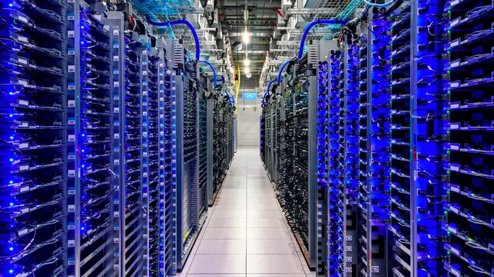
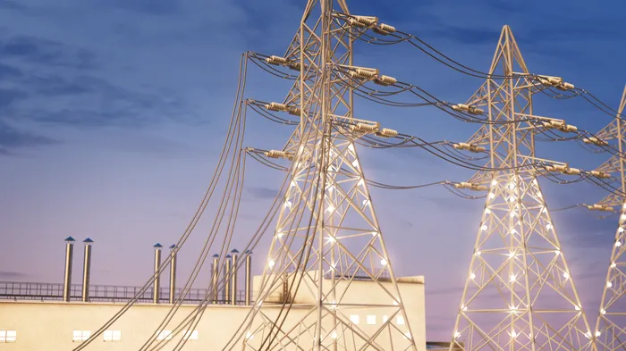
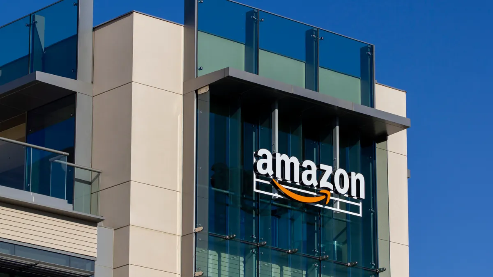

# Before You Learn AWS: The Story Behind the Cloud ☁️

> *This is Chapter 0 of my AWS Learning Journey series. No AWS jargon. No confusing diagrams. Just a story — and by the end of it, you'll understand why the cloud exists.*

---

## Let me ask you something first.

Imagine you wake up one morning with an idea.

Not just any idea. **The** idea.

You want to build an app. Something like Instagram, but for local food lovers. People post their home-cooked meals. Others can order from them. A community kitchen — in an app.

You're excited. You open your laptop. You start writing code.

Days pass. Weeks pass.

And then one morning — it's done. The app works. It looks beautiful. Your friends love it.

You're about to launch.

And then someone asks you a question you didn't expect.

> **"Where is this app going to *run*?"**

You pause.

You stare at your screen.

And slowly, you realise...

Writing the app was only *half* the battle.

---

## 🖥️ It Has to Live Somewhere

Here's something most tutorials skip.

Software doesn't just exist in the air. It runs on **physical machines** — computers with processors, memory, storage, and power.

Your laptop? That's a machine.
Your phone? That's a machine.
Google's search engine? That's running on *millions* of machines.

When someone opens your app, their phone sends a request somewhere. And that "somewhere" is a **server** — a computer that's always on, always connected to the internet, always ready to respond.



A server is basically just a very powerful computer. No screen. No keyboard. Just raw computing power, sitting in a room, waiting to do its job.

So when you ask "where will my app run?" — the real answer is: **on a server, somewhere in the world.**

Now comes the interesting part.

---

## 📅 Let's Go Back to 1999

You have the same idea. The food app. But it's 1999.

There's no AWS. No Google Cloud. No Azure.

If you want your app on the internet, here's what you have to do.

**Step 1:** Buy a server. (Costs: ₹5–10 lakhs minimum, or ~$5,000–10,000 USD)

**Step 2:** Find a place to put it — somewhere with stable electricity, cooling, and internet.

**Step 3:** Get a fast internet connection wired to that location. (Another big monthly bill)

**Step 4:** Install the operating system yourself.

**Step 5:** Configure the network, firewall, and security.

**Step 6:** Deploy your app.

**Step 7:** Hire someone to maintain all of this.

And you haven't even launched yet.

```
💡 App Idea
     ↓
🖥️  Buy a Server
     ↓
🏢  Rent Physical Space
     ↓
⚙️  Install & Configure Everything
     ↓
👨‍💻  Hire an IT Team
     ↓
🚀  Finally Launch  😅
     ↓
🙏  Pray it doesn't crash
```

This is what companies actually did. Big companies like banks, airlines, hospitals — they built entire **data centers**. Rooms (sometimes entire buildings) full of servers, with backup generators, cooling systems, and 24/7 staff.

It was expensive. It was slow. And it had one massive problem.

---

## 📈 What Happens When You Get Popular?

Let's say your app launches and suddenly — it blows up.

100 users become 1,000. Then 10,000. Then overnight, some food blogger shares it and you hit 1 million users in a week.

Your server starts struggling. Pages load slowly. Then they don't load at all.

You need more servers. Fast.

But here's the thing — you can't just *magic* a server into existence. You have to:

- Order it (takes weeks to ship)
- Install it (takes days)
- Configure it (takes more days)

By the time your new server is ready, your moment has passed. Users left. They moved on.

```
🚀  App goes viral
     ↓
🔥  Server overloaded
     ↓
😤  Users see errors
     ↓
📦  Order new servers
     ↓
⏳  Wait 2–4 weeks for delivery
     ↓
📬  Servers finally arrive
     ↓
💔  The moment is gone
```

This wasn't a rare problem. It happened to **everyone**.

And on the flip side — what about the slow months?

You bought 10 servers to handle your peak traffic. But 8 months of the year, you're using only 2 of them. Those other 8 servers are just sitting there. Consuming electricity. Doing nothing. Costing you money every single day.

You're paying for capacity you're not using.

It was a lose-lose situation.

---

## 🤔 Someone, Somewhere Had a Wild Idea

Around the early 2000s, a few very smart engineers started asking a question:

> *What if computing power could work like electricity?*

Think about electricity. You don't build a power plant in your house. You plug into the grid. You use what you need. You pay for what you use. When you need more, you use more. When you need less, you use less.

What if servers worked the same way?

What if instead of buying and managing physical machines... you could just **rent** computing power over the internet, scale it up or down instantly, and pay only for what you actually used?

That idea — that mental shift — is what gave birth to **cloud computing**.



---

## ☁️ What Even Is "The Cloud"?

Here's the honest answer that most people won't give you.

"The cloud" is not magic. It's not a mysterious force floating above us.

**The cloud is just someone else's computer.**

More specifically — it's a massive network of servers owned by a company, connected to the internet, that you can rent and use whenever you need them.

When you save a photo to Google Photos, it goes to Google's servers.
When you watch Netflix, the video streams from Netflix's servers.
When a company says "we moved to the cloud," they mean they stopped running their own servers and started renting space on someone else's.

**The Old Way 😓**
```
🧑‍💻 Your App  →  🖥️ Your Server  →  🏢 Your Data Center  →  😅 Your Problem
```

**The Cloud Way 😎**
```
🧑‍💻 Your App  →  🌐 Internet  →  ☁️ Cloud Provider's Servers  →  😎 Their Problem
```

Simple. Elegant. And it changed everything.

---

## 🚀 Enter Amazon Web Services

Now here's a plot twist you probably didn't expect.

The company that figured out how to do this at massive scale — and offer it to the world — wasn't a tech company in the traditional sense.

It was a **bookstore**.

Amazon.com started in 1994 selling books online. But to run their website, they had to build an enormous amount of internal infrastructure — servers, networking, databases, storage systems.

And at some point around 2002–2003, Amazon's engineers realised something.

They had gotten *really, really good* at building and managing this infrastructure. So good, in fact, that they started offering these internal tools to other developers as a service.

In **2006**, Amazon Web Services officially launched.

And the world of software was never the same again.



---

## 🌍 What Does AWS Actually Give You?

Remember our food app from the beginning?

Here's that same story — but in 2025.

You finish building the app. Someone asks where it will run.

You smile.

You open your browser. You go to AWS. You create an account.

In **15 minutes**, you have:

- A server running somewhere in the world ✅
- Storage for your images and data ✅
- A database for your users ✅
- Automatic scaling — if 1 million users arrive tonight, AWS handles it ✅
- Pay only for what you use ✅

No hardware. No data center. No waiting weeks for a delivery.

Just you, a browser, and the power of rented infrastructure at your fingertips.

```
💡 App Idea
     ↓
👨‍💻  Write Your Code
     ↓
🌐  Open AWS Console
     ↓
⚡  Deploy in Minutes
     ↓
🎉  App is Live
     ↓
📈  Scales automatically as users grow
```

That's the power of cloud computing. That's why AWS exists.

And that's the foundation for everything we're going to learn in this series.

---

## 🗺️ Where Are We Headed?

This was Chapter 0. The origin story.

## 🗺️ Where Are We Headed?

This was Chapter 0. The origin story.

Here's how the full journey looks:

**Ch 00** — ✅ Before You Learn AWS *(you are here)*
**Ch 01** — The World Before AWS: Computers, Servers & The Internet
**Ch 02** — Welcome to AWS: What It Is and How It's Organised
**Ch 03** — Your First AWS Service: EC2
**Ch 04** — Storage in the Cloud: S3
**Ch 05** — Who Can Do What: IAM
**Ch 06** — Networking on AWS: VPC
**Ch 07** — and the journey continues...

Two chapters of context. Then pure AWS — every single post.

---

### Now here's the thing.

You might be tempted to skip Chapter 1.

*"Computers, servers, internet — I already know this stuff."*

Maybe you do. But Chapter 1 isn't about what these things are.

It's about **why they broke** — and why that brokenness made AWS inevitable.

That shift in perspective is what makes every AWS service *click* instead of just being another thing to memorise.

👉 **[Chapter 1: The World Before AWS → (Read it here)](LINK)**

---

## 💬 One Last Thing Before You Go

Most AWS tutorials throw you straight into the console.

Create a bucket. Launch an instance. Configure a VPC.

You click along. You follow steps. And somewhere in the middle, you realise — you have no idea *why* you're doing any of this.

This series is different.

Every service we learn, we'll first ask: **what problem does this solve?**

Because that one question makes everything stick.

---

*Resources I'm learning from:*
- *[roadmap.sh/aws](https://roadmap.sh/aws) — my learning roadmap*
- *[AWS Official Overview Whitepaper](https://docs.aws.amazon.com/whitepapers/latest/aws-overview/introduction.html) — straight from the source*

---

*#aws #cloud #beginners #devjourney #learnaws*