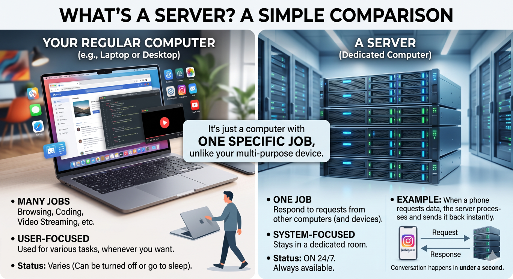
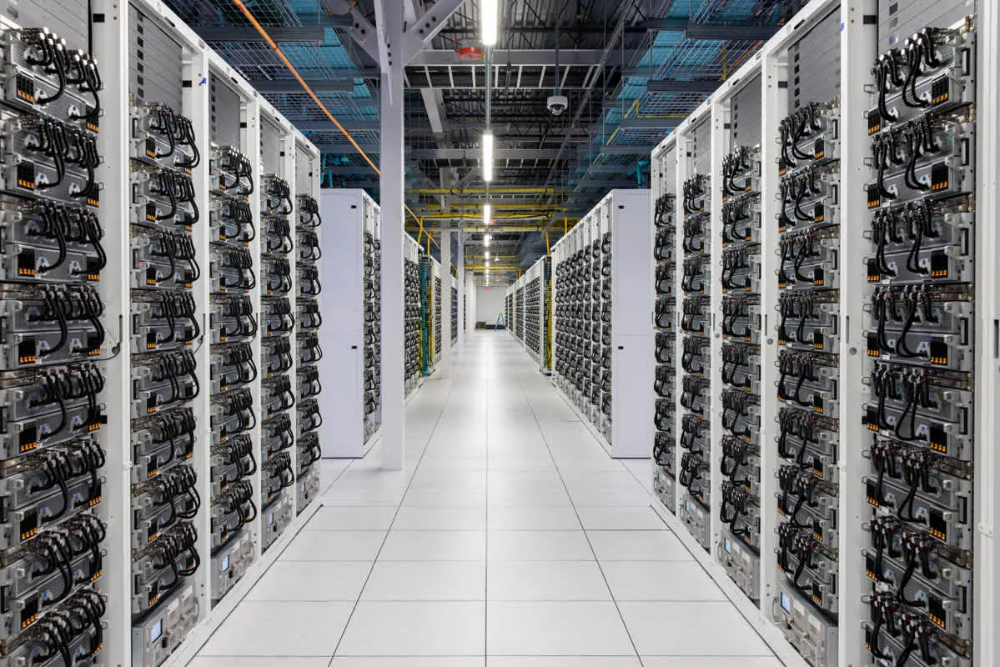

# The World Before AWS: Computers, Servers & The Internet ⚡

> *Chapter 1 of the AWS Learning Journey. No fluff. Just the story of how the old world broke — and why AWS was the only way out.*

---

## You Already Know the Ending.

In Chapter 0, we saw what AWS can do.

15 minutes. One browser. Your app is live, scalable, and ready for a million users.

But here's what we didn't talk about.

**How did we get there?**

Because AWS didn't appear out of nowhere. It was built to solve real, painful, expensive problems that broke real companies.

And to understand those problems — you need to understand the world that existed before AWS was even an idea.

This is that story.

---

## 🖥️ What Is a Computer, Really?

Let's not overthink this.

A computer is a machine that takes input, processes it, and gives you output.

You type a message → it processes → the message appears on screen.
You click "pay" → it processes → your order goes through.
Someone opens your app → it processes → they see your homepage.

That last one is the important one.

Every single thing that happens in software — every click, every login, every video that loads — is a computer somewhere doing its job.

Your laptop is a computer. Your phone is a computer. And the thing that runs your app when someone halfway across the world opens it?

Also a computer.

Just a very different kind.

---

## 🗄️ So What's a Server?

Here's where most explanations get confusing. They don't need to be.

A server is just a computer with one job.

Your laptop does many things — you browse, you code, you watch videos, you close the lid and walk away. A server does *one* thing: it sits in a room, stays on 24/7, and responds to requests from other computers.

When you open Instagram, your phone sends a request to Instagram's servers. The server processes it and sends back your feed. That entire conversation happens in under a second.



Your laptop could technically act as a server. But imagine leaving your laptop on 24/7, never closing it, handling thousands of requests per second, and keeping it connected to a fast internet line at all times.

That's not realistic. That's why servers exist — purpose-built machines designed for exactly that job.

---

## 🌐 How Does the Internet Fit In?

Think of the internet as a massive postal system.

Every device connected to it has an address — an IP address. When you open an app, your device sends a tiny letter to the server's address saying *"hey, give me this page."* The server reads it, prepares the response, and sends it back to your address.

This all happens through physical cables, undersea fibre lines, and wireless towers — infrastructure that spans the entire planet.


The internet isn't magic. It's pipes. Very fast, very global pipes.

And your server needs to be connected to those pipes — with a fast, stable, always-on connection — for your app to work for anyone outside your house.

---

## 🏢 Enter the Data Center

So companies needed servers. And servers needed:

- Stable electricity (24/7, no cuts)
- Cooling systems (servers generate enormous heat)
- Fast internet connections
- Physical security
- People to maintain them

You can't just put a server in your bedroom. So companies built **data centers** — dedicated buildings designed specifically to house and run servers at scale.

```
🏢 A Data Center is basically:

⚡ Uninterrupted power supply
❄️  Industrial cooling systems
🔌  High-speed internet lines
🔒  Physical security
👨‍🔧  On-site engineers, 24/7
🖥️  Row after row after row of servers
```

Big companies like banks, airlines, and retail chains built their own. Smaller companies rented space inside someone else's.

Either way — it was expensive. It was slow to set up. And it came with a problem that nobody had really solved yet.



> 📸 **Image:** Search `"data center interior rows of servers"` — the scale of a real data center is something readers need to *see* to understand.

---

## 💥 The Three Problems Nobody Could Fix

This is the part we promised you.

The old world wasn't just inconvenient. It was fundamentally broken in three ways.

---

### Problem 1 — It Was Slow to Scale 🐢

Your app gets popular overnight. You need more servers.

But servers don't appear instantly. You order them, wait weeks for delivery, physically install them, configure them, test them.

By the time you're ready — the moment is gone.

And scaling *down* was just as painful. You bought 20 servers for a big product launch. The launch ends. Now 15 servers sit idle, burning electricity, collecting dust, still costing you money every single month.

```
📈 Traffic spikes     →   😤 Can't scale fast enough
📉 Traffic drops      →   💸 Still paying for unused servers
```

There was no in-between. No flexibility. Just waste.

---

### Problem 2 — It Was Brutally Expensive 💰

Let's talk numbers — even rough ones.

One decent server in the early 2000s: **$3,000–$5,000**
Data center space rental per month: **$300–$1,400+**
Internet connectivity: **$800+/month**
IT staff to run it all: **$30,000–$80,000/year per person**

And this was just to *start*.

Most startups couldn't afford this. Which meant most ideas never became products. Not because the idea was bad — but because the infrastructure cost killed it before it could breathe.

---

### Problem 3 — It Was Your Problem to Maintain 🔧

When a server crashes at 3am — that's your problem.

When a hard drive fails — that's your problem.

When you need to update the operating system across 50 machines — that's your problem.

Companies were spending enormous amounts of time and money just *keeping the lights on*. Engineers who should have been building products were instead babysitting hardware.

The actual work — the software, the features, the product — always came second.

---

## 🌩️ The Breaking Point

By the mid-2000s, the internet was exploding.

More people online. More apps. More traffic. More demand for servers than ever before.

And the old model simply couldn't keep up.

Startups were dying not because they had bad products — but because they couldn't afford the infrastructure to run them. Big companies were drowning in maintenance costs. Everyone was over-provisioning, over-spending, and under-delivering.

Something had to give.

And quietly, inside a company that was best known for selling books online — a different approach was taking shape.

---

## ☁️ The Shift That Changed Everything

Amazon had been dealing with all three of these problems internally for years.

They'd built powerful infrastructure to run Amazon.com — and in doing so, they got exceptionally good at it. Then they had a thought:

> *What if we let other companies use this infrastructure too?*

Rent it out. By the hour. Scale it up or down on demand. No hardware to buy. No data centers to manage. Just computing power, available instantly, over the internet.

Pay for what you use. Stop paying when you don't.

That idea became **Amazon Web Services**.

And starting in 2006, the three problems that had broken the old world started to have answers.

---

## 🗺️ Where We Go From Here

Chapter 1 is done. The painful backstory is behind us.

Here's where we stand:

**Ch 00** — ✅ The origin story

**Ch 01** — ✅ The world before AWS *(you are here)*

**Ch 02** — Virtualization & Cloud Models: The Missing Bridge

**Ch 03** — Welcome to AWS: Infrastructure, Console & Free Tier

**Ch 04** — IAM: The Gatekeeper of AWS

**Ch 05** — EC2: Your First Server in the Cloud

**Ch 06** — EBS, AMI & Auto Scaling: The Complete Compute Picture


**Ch 07** — AWS CLI: Stop Clicking, Start Typing

**Ch 08** — S3: Store Anything, Forever

**Ch 09** — Databases on AWS: RDS & DynamoDB

**Ch 10** — Serverless: Lambda, SNS & SQS

**Ch 11** — Monitoring & Secrets: CloudWatch + Secrets Manager

**Ch 12** — Networking: Route 53, CloudFront & VPC

**Ch 13** — Infrastructure as Code: CloudFormation & Terraform

**Ch 14** — Containers: ECS & EKS

**Ch 15** — Billing & Pricing: Never Get a Surprise Bill

**Ch 16** — Capstone: Build a Full Stack App on AWS

**Ch 17** — AWS vs Azure vs GCP: An Honest Comparison

**Ch 18** — What's Next: The AWS Certifications Roadmap

From the next chapter — it's pure AWS. No more backstory. No more history.

Just the actual services, why they exist, and how to use them.

---

### One Thing Before You Click Away.

You've just seen why the old world broke.

Chapter 2 is the bridge between that broken world and AWS — the technical idea that made cloud computing *physically possible* in the first place.

It's called virtualization. And once you understand it, EC2 will make complete sense before you even launch your first instance.

👉 **[Chapter 2: Virtualization & Cloud Models → (Read it here)](https://dev.to/)**

---

*Resources I'm learning from:*
- *[roadmap.sh/aws](https://roadmap.sh/aws) — my learning roadmap*
- *[AWS Official Overview Whitepaper](https://docs.aws.amazon.com/whitepapers/latest/aws-overview/introduction.html) — straight from the source*

---

*#aws #cloud #beginners #devjourney #learnaws*