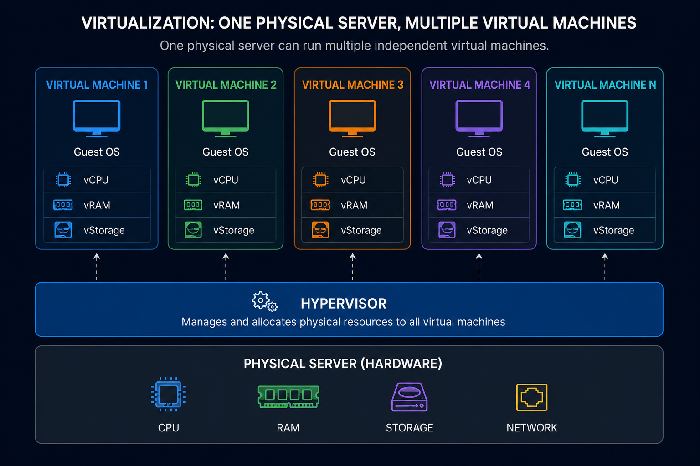
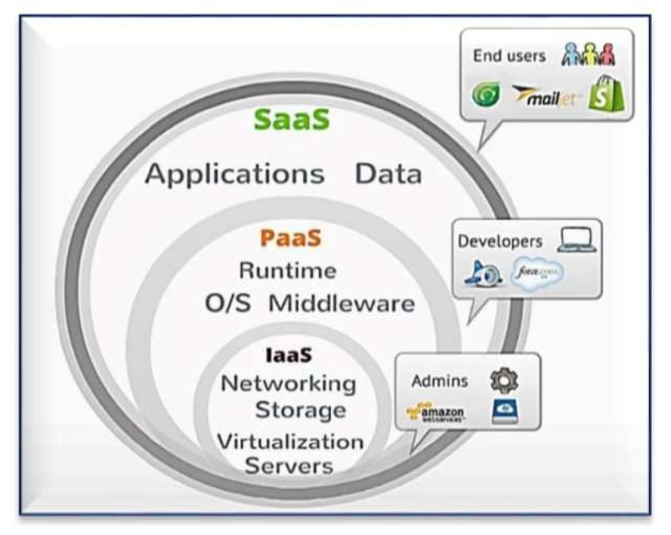

# Virtualization & Cloud Models: The Missing Bridge 🌉

> *Chapter 2 of the AWS Learning Journey. We promised you pure AWS from here. But before we get there — there's one idea that makes everything else make sense. This is it.*

---

## Something We Never Explained.

In Chapter 1, we left you with a broken world.

Expensive servers. Slow scaling. Your problem to maintain.

And then we said — AWS fixed it.

But we skipped something important.

**How?**

How does a company like AWS take physical machines sitting in a building somewhere and turn them into something thousands of companies can rent, by the hour, on demand?

The answer isn't magic. It isn't even that complicated once someone explains it properly.

It's called **virtualization**.

And it's the idea that made cloud computing physically possible.

---

## 🖥️ Let's Start With a Problem

Cast your mind back to a data center in 2001.

A company buys a powerful server. It has 32 cores, 256GB of RAM, and terabytes of storage.

They run one application on it.

That application uses maybe 10% of the server's power at any given time.

The other 90%?

Just sitting there. Idle. Wasted.

Now multiply that across hundreds of servers in a data center.

```
🖥️  Server 1   →   Running App A   →   Using 10% capacity
🖥️  Server 2   →   Running App B   →   Using 15% capacity
🖥️  Server 3   →   Running App C   →   Using 8% capacity
🖥️  Server 4   →   Running App D   →   Using 20% capacity

💸  Combined waste: ~75% of total computing power
    sitting idle every single day
```

Someone, somewhere looked at this and asked a very sensible question.

> *What if one physical machine could pretend to be many machines?*

---

## 💡 The Big Idea: One Machine, Many Lives

Here's the concept that changed everything.

What if you could take that one powerful server and divide it into multiple **virtual machines** — each one behaving exactly like a separate, independent computer?

Each virtual machine gets its own slice of the CPU, its own slice of RAM, its own storage. It runs its own operating system. It doesn't know — or care — that other virtual machines exist on the same physical hardware.

From the outside, it looks and feels like a real, dedicated server.

But underneath, it's sharing physical resources with several others.




This is **virtualization**.

And suddenly, that server running at 10% capacity?

Now it's running 8 virtual machines, each at around 10% — utilising nearly the full machine.

No wasted power. No wasted money.

---

## ⚙️ What Makes This Possible: The Hypervisor

You're probably wondering — what actually does the dividing?

Meet the **hypervisor**.

A hypervisor is a piece of software that sits between the physical hardware and the virtual machines. Its entire job is to manage and allocate resources — making sure each virtual machine gets its slice and stays in its lane.

There are two types, and they're worth knowing.

---

### Type 1 — Bare Metal Hypervisor

This one runs **directly on the hardware**. No operating system in between.

```
⚙️  Physical Hardware
        ↓
🔧  Hypervisor (Type 1 — runs directly on hardware)
        ↓
🖥️ VM1   🖥️ VM2   🖥️ VM3
```

Faster. More efficient. Used in enterprise data centers and — importantly — by AWS.

Examples: VMware ESXi, Microsoft Hyper-V, Xen (which AWS used for years)

---

### Type 2 — Hosted Hypervisor

This one runs **on top of an existing operating system** — like an app you install.

```
⚙️  Physical Hardware
        ↓
💻  Host Operating System (Windows / macOS / Linux)
        ↓
🔧  Hypervisor (Type 2 — runs as an application)
        ↓
🖥️ VM1   🖥️ VM2
```

Slower than Type 1 but easier to set up. Used mostly for development and testing on personal machines.

Examples: VirtualBox, VMware Workstation

---

The distinction matters for one reason: **AWS uses Type 1**. When you launch an EC2 instance later in this series, you're getting a virtual machine created and managed by a bare-metal hypervisor running on AWS's physical hardware. Now you know what's actually happening underneath.

---

## ☁️ From Virtualization to Cloud Computing

Once virtualization existed, the leap to cloud computing was logical.

If you can divide one physical server into many virtual ones — why not build a massive warehouse of physical servers, virtualise all of them, and rent out those virtual machines to anyone who needs one?

Need a server for your app? You get a virtual machine.
Need it for an hour? Pay for an hour.
Need 100 of them for a traffic spike? Spin up 100.
Traffic drops? Shut them down. Stop paying.

That's cloud computing. Virtualization at massive scale, made available over the internet.

```
🏭  AWS Data Center (thousands of physical servers)
              ↓
🔧  Hypervisors running on every machine
              ↓
☁️  Pool of virtual machines available on demand
              ↓
🧑‍💻  You log in and rent exactly what you need
              ↓
💳  Pay only for what you use
```

Simple in concept. Extraordinary in execution.

---

## 📦 But What Exactly Are You Renting?

Here's where it gets interesting — because "cloud computing" isn't one thing.

Depending on how much control you want (and how much responsibility you're willing to take on), you can rent different *levels* of the stack.

This is where **IaaS, PaaS, and SaaS** come in.

Don't let the acronyms scare you. The idea is simple.

---

### 🏗️ IaaS — Infrastructure as a Service

**You get:** Virtual machines, storage, networking.
**You manage:** Operating system, runtime, apps, data.
**AWS example:** EC2

Think of it like renting an empty plot of land. The foundation is there. You build everything else yourself.

Maximum control. Maximum responsibility.

```
AWS manages  →  Physical hardware, hypervisor, networking
You manage   →  OS, runtime, code, data, security config
```

This is where most of your AWS learning will live. EC2 is IaaS.

---

### 🧱 PaaS — Platform as a Service

**You get:** A ready-made environment to deploy your code.
**You manage:** Your application and data only.
**AWS example:** AWS Elastic Beanstalk, AWS Lambda (partially)

Think of it like renting a fully furnished apartment. The infrastructure is handled. You just move in and live.

Less control. Less responsibility. Faster to deploy.

```
AWS manages  →  Hardware, OS, runtime, scaling, patching
You manage   →  Your code and your data
```

---

### 📱 SaaS — Software as a Service

**You get:** A fully working application.
**You manage:** Nothing technical — just use it.
**Examples:** Gmail, Dropbox, Slack, Zoom

Think of it like staying in a hotel. Everything is done for you. You just show up.

No control over infrastructure at all. Not really an AWS category — but understanding it completes the picture.

```
Provider manages  →  Everything
You manage        →  Your account and your data
```

---

### The Full Picture Side by Side

```
                IaaS        PaaS        SaaS
Hardware         AWS         AWS         AWS
Networking       AWS         AWS         AWS
Hypervisor       AWS         AWS         AWS
OS               YOU         AWS         AWS
Runtime          YOU         AWS         AWS
Code             YOU         YOU         AWS
Data             YOU         YOU         YOU
```

The further right you go — the less you manage, but also the less flexibility you have.

Most of this series lives in **IaaS territory** — because that's where AWS services like EC2, S3, VPC, and RDS sit.



---

## 🧩 Why This Chapter Existed

We could have started Chapter 3 with "open the AWS console and create an account."

But then when you launch an EC2 instance and AWS gives you a virtual machine — you'd be clicking buttons without knowing what you're actually getting.

Now you know.

When AWS gives you an EC2 instance — you're getting a **virtual machine**, created by a **Type 1 hypervisor**, running on physical hardware inside an **AWS data center**, available to you as **IaaS**.

That one sentence will make EC2 feel completely natural when we get there.

---

## 🗺️ Where We Go From Here

**Ch 00** — ✅ The origin story

**Ch 01** — ✅ The world before AWS

**Ch 02** — ✅ Virtualization & Cloud Models *(you are here)*

**Ch 03** — Welcome to AWS: Infrastructure, Console & Free Tier

**Ch 04** — IAM: The Gatekeeper of AWS

**Ch 05** — EC2: Your First Server in the Cloud

**Ch 06** — EBS, AMI & Auto Scaling: The Complete Compute Picture

**Ch 07** — AWS CLI: Stop Clicking, Start Typing

**Ch 08** — S3: Store Anything, Forever


**Ch 09** — Databases on AWS: RDS & DynamoDB

**Ch 10** — Serverless: Lambda, SNS & SQS

**Ch 11** — Monitoring & Secrets: CloudWatch + Secrets Manager

**Ch 12** — Networking: Route 53, CloudFront & VPC

**Ch 13** — Infrastructure as Code: CloudFormation & Terraform

**Ch 14** — Containers: ECS & EKS

**Ch 15** — Billing & Pricing: Never Get a Surprise Bill

**Ch 16** — Capstone: Build a Full Stack App on AWS

**Ch 17** — AWS vs Azure vs GCP: An Honest Comparison

**Ch 18** — What's Next: The AWS Certifications Roadmap

---

### Before You Go.

The backstory is fully done now.

Three chapters in — you understand *why* cloud exists, *why* the old world broke, and *how* virtualization made the cloud technically possible.

Chapter 3 is where we finally walk through the door.

We'll look at how AWS is structured globally, what the console looks like, and — crucially — how to set up your account without accidentally paying for anything.

Yes, that last part matters.

👉 **[Chapter 3: Welcome to AWS → (Read it here)](dev.to)**

---

*Resources I'm learning from:*
- *[roadmap.sh/aws](https://roadmap.sh/aws) — my learning roadmap*
- *[AWS Official Overview Whitepaper](https://docs.aws.amazon.com/whitepapers/latest/aws-overview/introduction.html) — straight from the source*

---

*#aws #cloud #beginners #devjourney #learnaws*
