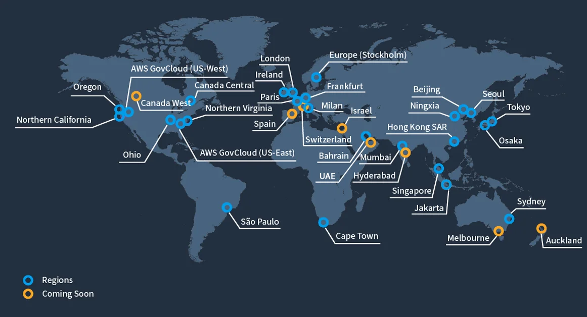
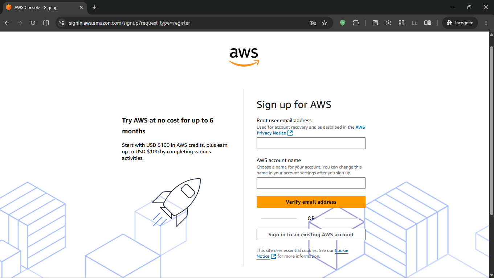
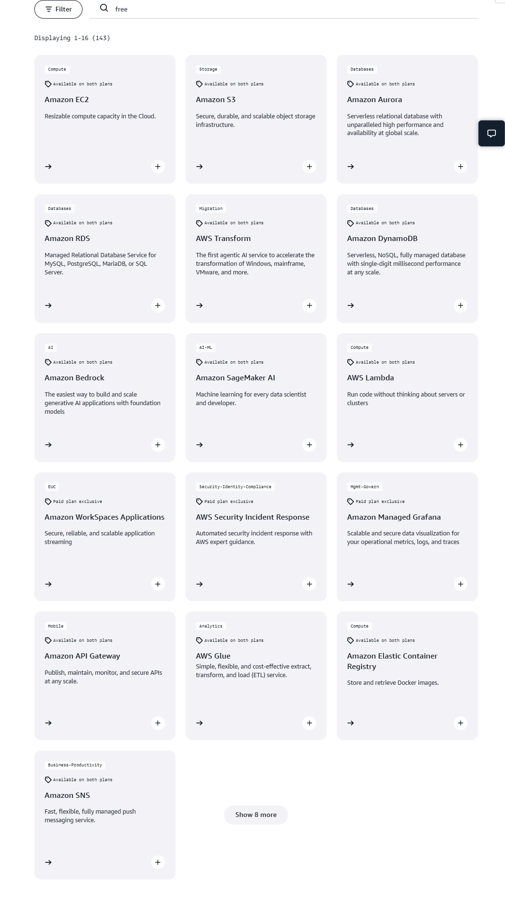
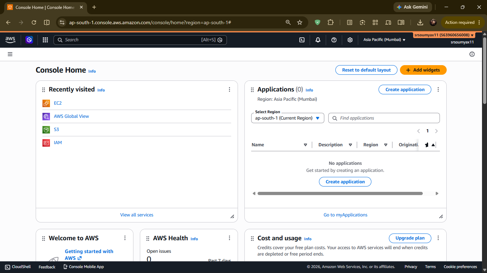
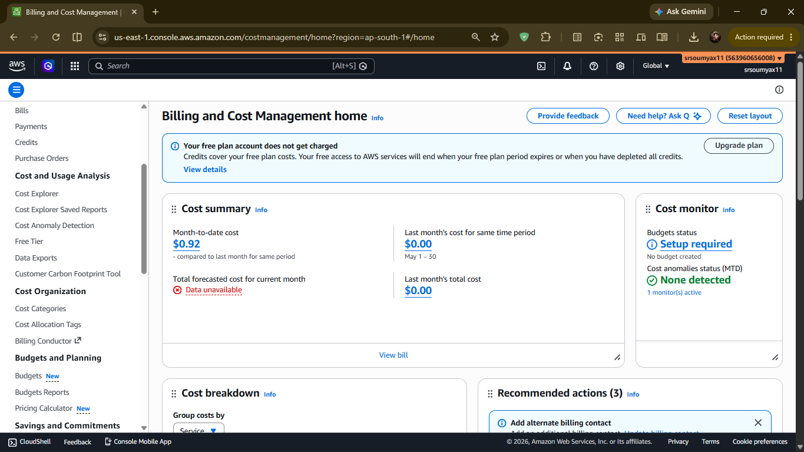
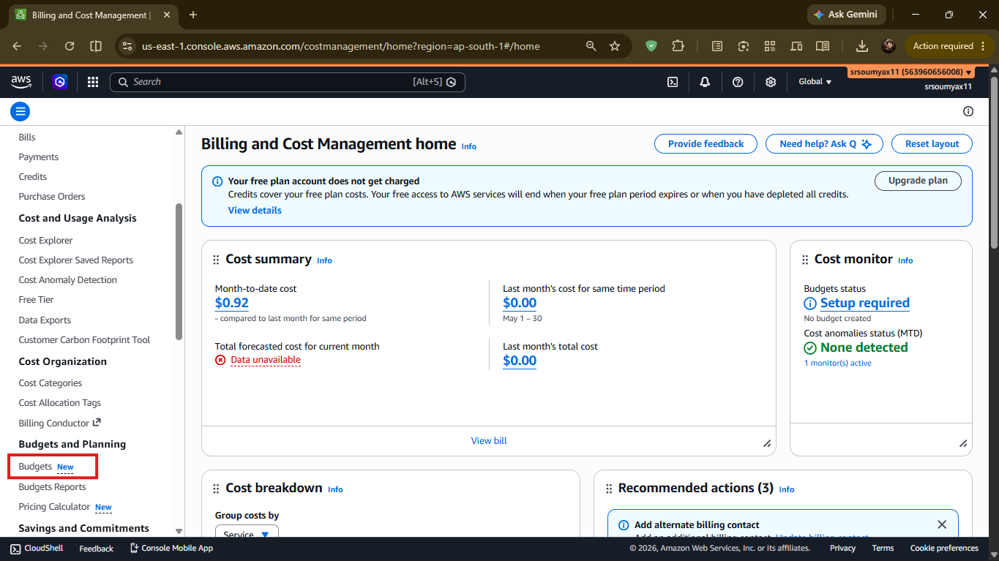
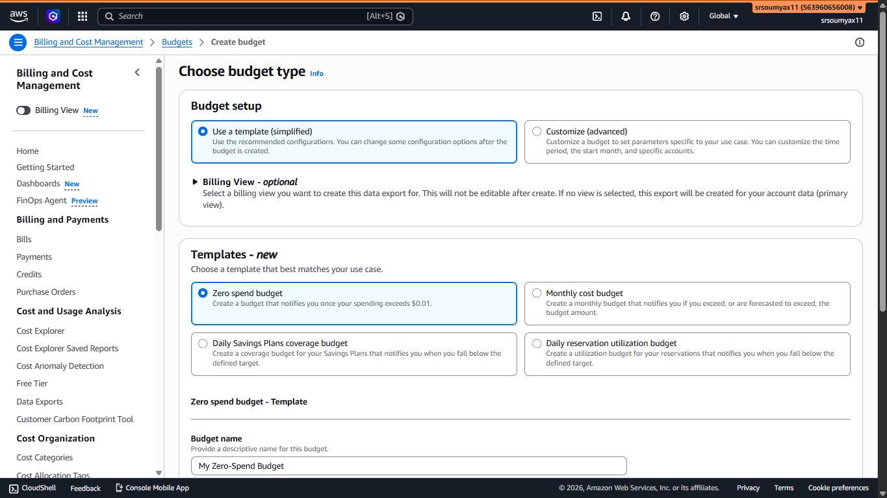
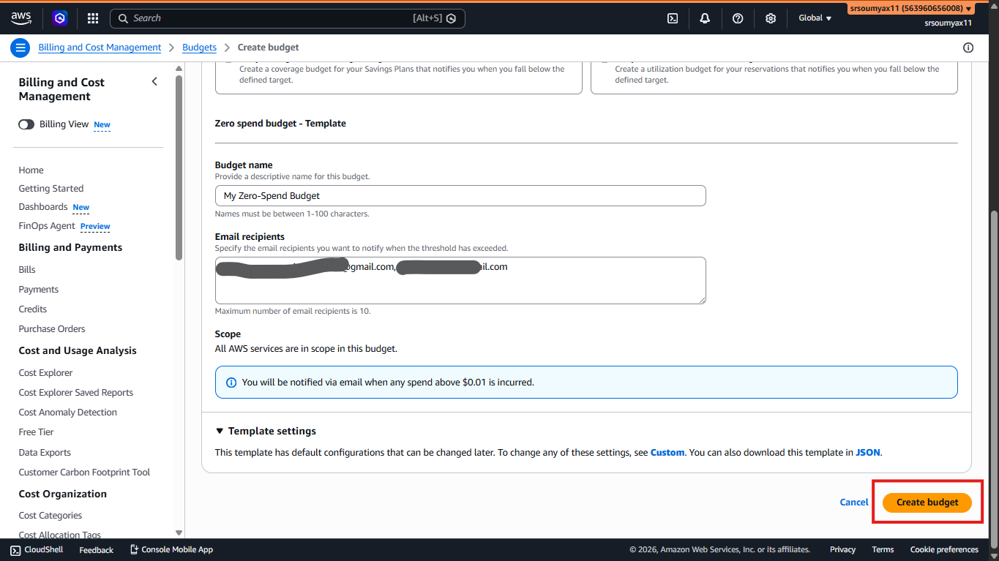

# Welcome to AWS: Infrastructure, Console & Free Tier 🌍

> *Chapter 3 of the AWS Learning Journey. Three chapters of context. Now we finally walk through the door.*

---

## The Door Is Open.

[Chapter 0](https://dev.to/srsoumyax11/before-you-learn-aws-the-story-behind-the-cloud-2bed) - you understood why cloud exists.

[Chapter 1](https://dev.to/srsoumyax11/the-world-before-aws-computers-servers-the-internet-3m0) - you understood why the old world broke.

[Chapter 2](https://dev.to/srsoumyax11/virtualization-cloud-models-the-missing-bridge-f60) - you understood how virtualization made cloud possible.

That's three chapters without touching AWS once.

And that was intentional.

Because most people open the AWS console on day one - see 200+ services staring back at them - and immediately feel lost.

You won't feel that way.

You already know what AWS is solving and how it works under the hood. Now we just need to learn the building - which floor things are on, where the entrance is, and how to not accidentally leave the lights on when you leave.

Let's go in.

---

## 🌍 How AWS Is Built: The Global Infrastructure

Before we log in, there's one thing worth understanding about how AWS is physically structured around the world.

Because AWS isn't one data center somewhere.

It's a global network - and understanding how it's organised will explain a lot of decisions you'll make later.

---

### Regions 🗺️

A **Region** is a specific geographic location where AWS has built a cluster of data centers.

As of 2026, AWS has 39 Regions worldwide - places like US East (Virginia), EU West (Ireland), Asia Pacific (Mumbai), and so on.

When you launch a server on AWS, you choose which Region it lives in.




Why does this matter?

Two reasons:

**Speed** - The closer your server is to your users, the faster your app loads. If most of your users are in India, you'd choose the Mumbai Region, not Virginia.

**Compliance** - Some industries and countries require data to stay within specific geographic boundaries. A European bank might be legally required to keep data inside EU Regions.

Regions are completely independent of each other. If one Region has a problem, others are unaffected.

---

### Availability Zones ⚡

Inside each Region, AWS doesn't just have one data center. It has multiple - called **Availability Zones** (AZs).

Mumbai Region, for example, has 3 Availability Zones - three separate physical data centers, each in a different location within the city, with their own power, cooling, and networking.

```
🌍 AWS Region: Asia Pacific (Mumbai)
        │
        ├── ⚡ Availability Zone 1  (ap-south-1a)
        ├── ⚡ Availability Zone 2  (ap-south-1b)
        └── ⚡ Availability Zone 3  (ap-south-1c)
```

Why does this matter?

If your app runs in only one AZ and that data center has a power outage - your app goes down.

If your app runs across multiple AZs - one goes down, the others keep running. Your users notice nothing.

This is how big companies achieve that "99.99% uptime" you see in SLAs. We'll use this concept practically when we get to EC2 and load balancers.

---

### Edge Locations 🚀

One more piece - **Edge Locations**.

These are smaller AWS outposts spread across 400+ cities worldwide. They don't run your servers. Instead, they cache your content - images, videos, static files - closer to your users.

So when someone in Chennai opens your app hosted in Mumbai, they might actually get your images delivered from an Edge Location right in their city - making it even faster.

This is what AWS CloudFront uses. We'll cover it properly in Chapter 12.

For now just know: Regions run your infrastructure. Edge Locations deliver your content fast.

---

## 🔐 Creating Your AWS Account

Let's set up your account.

Go to **aws.amazon.com** and click "Create an AWS Account."

You'll need:

- An email address
- A password
- A phone number (for verification)
- A credit / debit card / UPI (A small amount (₹2) will be deducted and also get refunded after verification.)

That last one makes people nervous. Let's address it directly.

**Why does AWS need your card if there's a free tier?**

Because AWS bills you for anything you use beyond the free tier limits - automatically. Your card is the fallback. This is normal and fine.

The key is knowing what the free tier includes (we'll cover that next) and setting up a billing alert (we'll do that before this chapter ends).



During signup you'll be asked to choose a **Support Plan**. Choose **Basic - Free**. You do not need a paid support plan to learn AWS.

---

### Root User vs IAM User - A Quick Note

When you create an AWS account, the email you signed up with becomes your **root user**.

The root user has unlimited access to everything in your account. It can delete your entire setup, change billing, close the account - no restrictions.

> *This is why you almost never use it day-to-day.*

In Chapter 4, we'll create an **IAM user** - a separate login with only the permissions it needs - and that's what we'll use for everything from there onwards.

For now: create the account with your root email, log in once to set things up, then we'll lock it away properly in the next chapter.

---

## 🎁 The Free Tier - What's Actually Free

The AWS Free Tier is real and generous. But it has three different flavours and mixing them up is how people end up confused about bills.

---

**Always Free**
These never expire, regardless of how long you've had an account.

- AWS Lambda - 1 million requests per month
- DynamoDB - 25GB of storage
- CloudWatch - basic monitoring metrics

---

**12 Months Free**
Free for your first 12 months from account creation. After that, normal pricing kicks in.

- EC2 - 750 hours/month of t2.micro or t3.micro instances
- S3 - 5GB of standard storage
- RDS - 750 hours/month of db.t2.micro or db.t3.micro instances

These are the big ones. Most of what we do in this series fits comfortably inside these limits.

---

**Free Trials**
Short-term trials of specific services - usually 30 to 90 days from first use.

- Amazon SageMaker - 2 months free
- Amazon Redshift - 2 months free

---



**The golden rule of the free tier:**

Always check which category a service falls into before using it. The 12-months-free services will start charging after your first year - and t2.micro EC2 instances left running 24/7 will eat through your 750 free hours in about a month.

We'll talk about this more in Chapter 15 on billing. For now - the habit to build is: know before you launch.

---

## 🖥️ Your First Look at the Console

Log in at **console.aws.amazon.com** with your root user for now.

Here's what you're looking at:

**The top navigation bar**
On the left - the AWS logo and a services menu. In the middle - a search bar (use this constantly, it's the fastest way to find anything). On the right - your account name, Region selector, and support.

**The Region selector** is in the top right corner - it shows something like "ap-south-1" or "us-east-1". This tells you which Region you're currently working in. Always check this before launching anything. Many beginners launch resources in the wrong region and spend time wondering why they can't find them.

**The services menu**
Click the grid icon or search for any service by name. AWS organises services into categories - Compute, Storage, Database, Networking, Security, and so on. As the series progresses, you'll naturally learn which category each service lives in.

**The home dashboard**
You can customise this with shortcuts to services you use frequently. For now it's mostly empty - and that's fine.



Don't try to explore everything right now. The console only makes sense in context - and we'll build that context one service at a time starting from Chapter 4.

---

## 🚨 Do This Before Anything Else: Set a Billing Alert

This takes 5 minutes and will save you from ever getting a surprise bill.

**Step 1** - In the console search bar, type `Billing` and open Billing and Cost Management.



**Step 2** - In the left menu, click `Budgets` then `Create budget`.



**Step 3** - Choose `Use a template` → `Zero spend budget`.

This will send you an email the moment your account is charged anything beyond the free tier. Even $0.01.



**Step 4** - Enter your email address (separated by comma if you want multiple recipients) and create the budget.


Done. You now have an early warning system. Go explore without fear.


---

## 🗺️ Where We Go From Here


**Ch 00** - ✅ The origin story

**Ch 01** - ✅ The world before AWS

**Ch 02** - ✅ Virtualization & Cloud Models

**Ch 03** - ✅ Welcome to AWS *(you are here)*

**Ch 04** - IAM: The Gatekeeper of AWS

**Ch 05** - EC2: Your First Server in the Cloud

**Ch 06** - EBS, AMI & Auto Scaling: The Complete Compute Picture

**Ch 07** - AWS CLI: Stop Clicking, Start Typing

**Ch 08** - S3: Store Anything, Forever

**Ch 09** - Databases on AWS: RDS & DynamoDB

**Ch 10** - Serverless: Lambda, SNS & SQS

**Ch 11** - Monitoring & Secrets: CloudWatch + Secrets Manager

**Ch 12** - Networking: Route 53, CloudFront & VPC

**Ch 13** - Infrastructure as Code: CloudFormation & Terraform

**Ch 14** - Containers: ECS & EKS

**Ch 15** - Billing & Pricing: Never Get a Surprise Bill

**Ch 16** - Capstone: Build a Full Stack App on AWS

**Ch 17** - AWS vs Azure vs GCP: An Honest Comparison

**Ch 18** - What's Next: The AWS Certifications Roadmap

---

### Before You Click Away.

Your account is set up. The console is no longer a mystery. Your billing alert is live.

But right now - your AWS account is wide open.

One login. Full access to everything. No guardrails.

That changes in Chapter 4.

IAM is the first thing every AWS professional sets up before touching any service - because it controls *who* can do *what* inside your account. Get this wrong and your account can be compromised, your resources deleted, or your bill run up by someone else entirely.

It's also the chapter that separates beginners who click around from professionals who build securely.

👉 **[Chapter 4: IAM - The Gatekeeper of AWS → (Read it here)](LINK)**

---

*Resources I'm learning from:*
- *[roadmap.sh/aws](https://roadmap.sh/aws) - my learning roadmap*
- *[AWS Official Overview Whitepaper](https://docs.aws.amazon.com/whitepapers/latest/aws-overview/introduction.html) - straight from the source*

---

*#aws #cloud #awsaccount #freetier*
