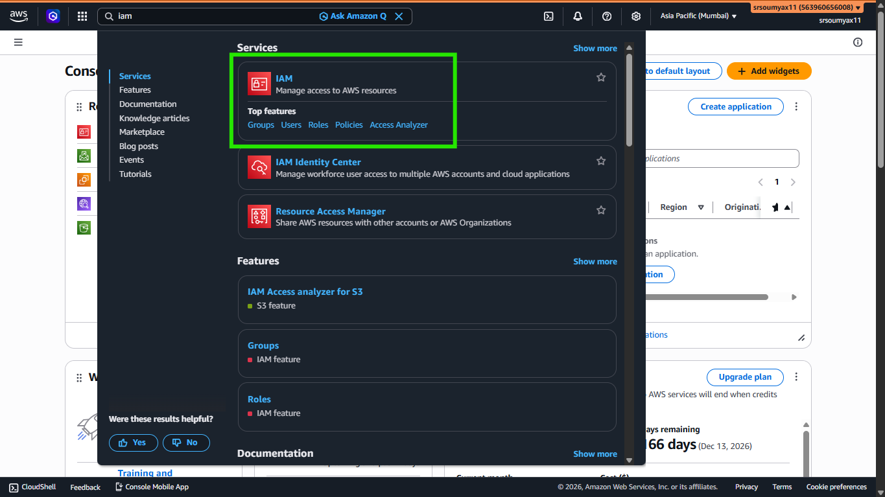
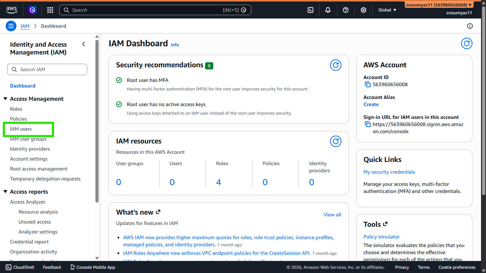
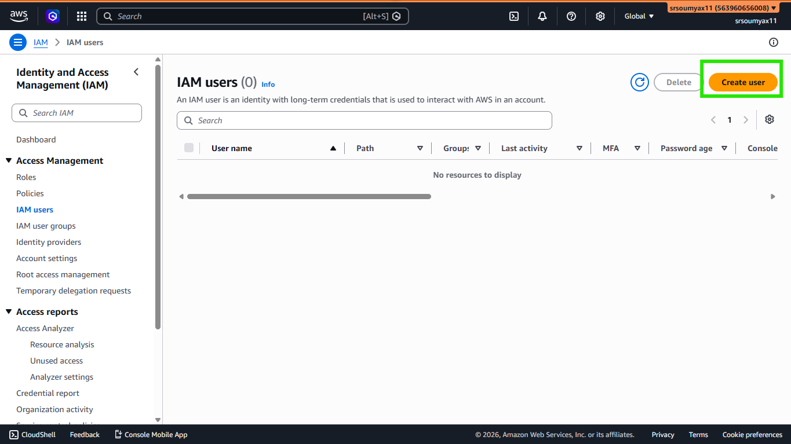
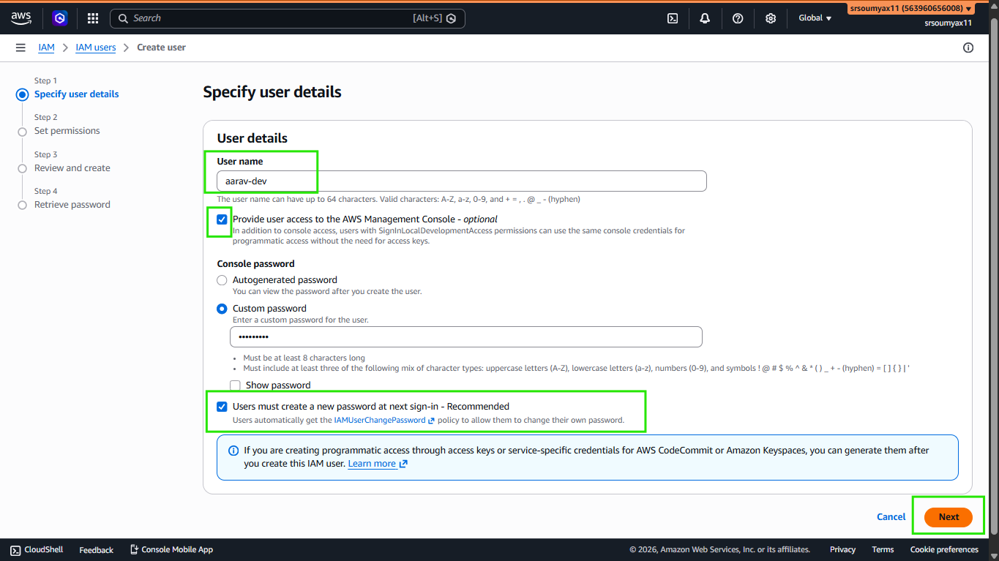
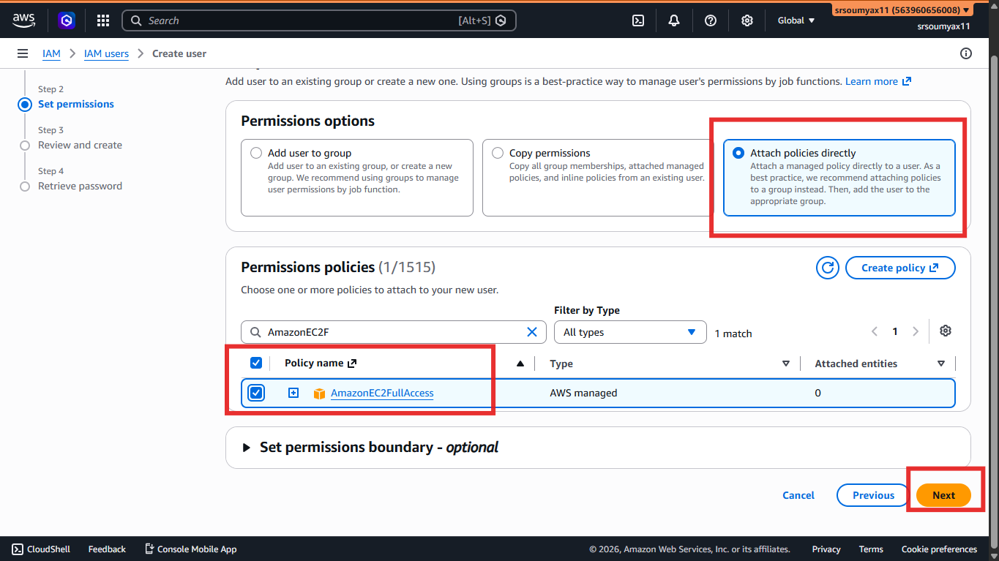
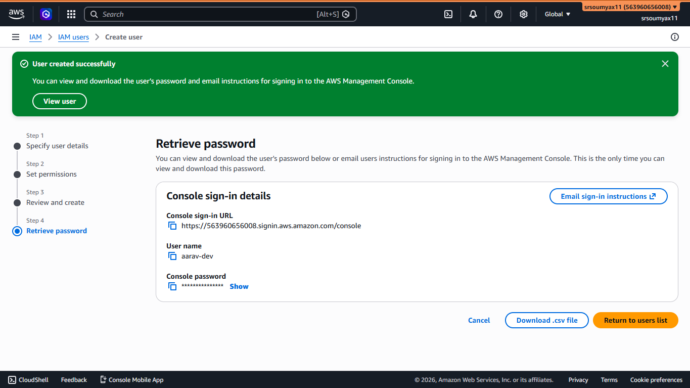
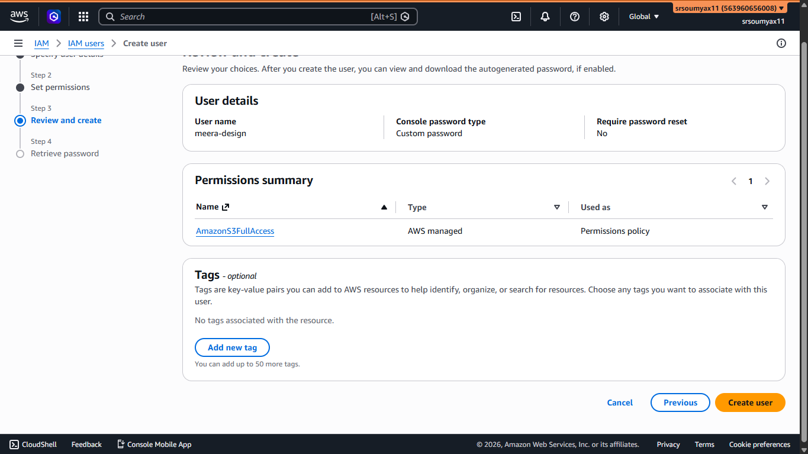
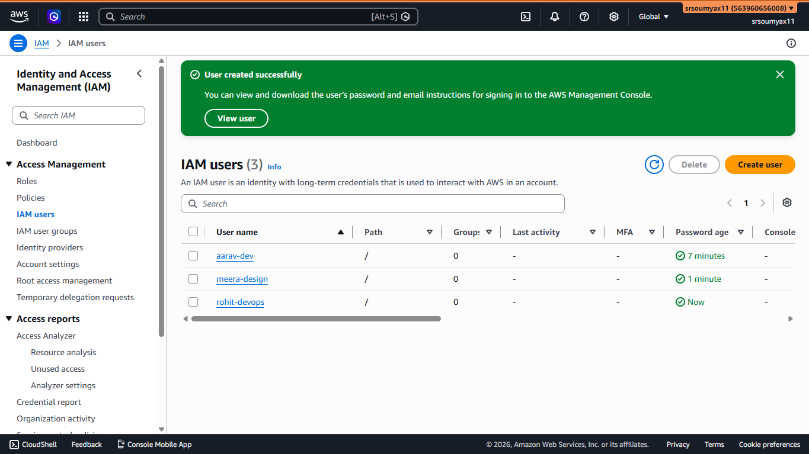
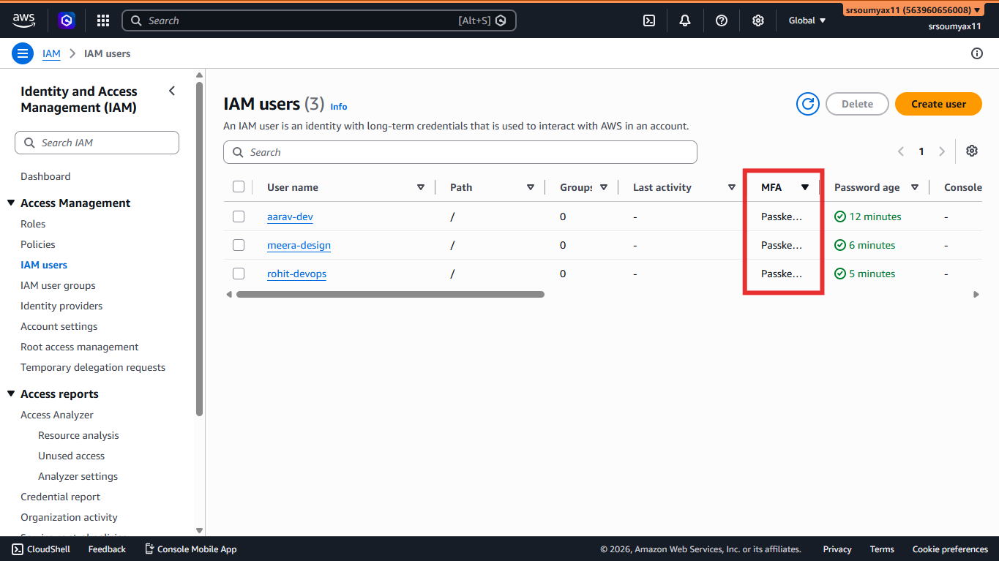

# Pixel & Spoon Hands-On: Creating Your First IAM User 👤

> *A hands-on companion to Chapter 4 — IAM: The Gatekeeper of AWS. Today, we create Aarav's login so he can finally get to work.*

---

## Quick Recap

In Chapter 4, we talked about why Pixel & Spoon can't hand out the root password to every team member.

Aarav, our backend developer, needs his own identity inside AWS — his own login, his own permissions, his own activity trail.

That's an **IAM user**.

Let's create his.

---

## ⚠️ Before You Start

Log in to AWS using your **root account** for this one time only. Creating users is exactly the kind of task root should still handle, until you've created an admin IAM user for yourself later in this series.

---

## 🛠️ Step-by-Step: Creating Aarav's IAM User

**Step 1 — Open IAM**

In the AWS Console search bar at the top, type `IAM` and click on it. This opens the IAM Dashboard.



---

**Step 2 — Go to Users**

On the left-hand sidebar, click **IAM Users**.


Click the orange **Create user** button in the top right.


---

**Step 3 — Enter User Details**

For the username, use something clear and consistent. For Aarav, we'll use:

```
aarav-dev
```

A good convention is `firstname-role` or `firstname.lastname` — pick one and stick with it across your whole team, it'll make managing users much easier later.

Check the box for **"Provide user access to the AWS Management Console"** — Aarav needs to log in and use the console himself.

You'll then be asked how he should sign in. Choose **"I want to create an IAM user"**, then select **"Custom password"** and set a temporary one. Tick **"User must create a new password at next sign-in"** — this way, Aarav sets his own password the first time he logs in, and you never actually know his real one.

Click **Next**.




---

**Step 4 — Set Permissions**

This is the important part.

You'll see three options:

```
○ Add user to group        ← Recommended (we'll set this up in Ch 4.2)
○ Copy permissions          ← Copies from an existing user
○ Attach policies directly  ← Manual, one-off permissions
```

Since we haven't created the Developers group yet (that's the very next post in this series), for now select **"Attach policies directly"** and search for:

```
AmazonEC2FullAccess
```

This gives Aarav exactly what he needs right now — the ability to launch and manage EC2 instances. Nothing more.



> 💡 In Chapter 4.2, we'll create a proper "Developers" group and move Aarav into it instead — so you're not managing his permissions individually forever. This step is just to get him working today.

Click **Next**.

---

**Step 5 — Review and Create**

You'll see a summary: username, console access enabled, and the policy attached.

Double check everything looks right, then click **Create user**.

---

**Step 6 — Save His Sign-In Details**

AWS will now show you a success screen with:

- The console sign-in URL
- Aarav's username
- His temporary password

**This password is shown only once.** Download the `.csv` file or copy these details immediately and share them with Aarav through a secure channel — never over email or chat in plain text.



```
🔗 Sign-in URL:  https://[your-account-id].signin.aws.amazon.com/console
👤 Username:     aarav-dev
🔑 Temp Password: [shown once — save it now]
```

---

## ✅ What Just Happened

Aarav now has his own identity inside Pixel & Spoon's AWS account.

He can log in independently, using his own credentials. He has exactly the permission he needs — EC2 access — and nothing else. His actions inside AWS are now tracked under his own name, not the root account.

Repeat this exact process for Meera and Rohit — just give them appropriate temporary policies for now (we'll clean this up properly with groups next):

- **Meera** → username `meera-design` → attach `AmazonS3FullAccess`



- **Rohit** → username `rohit-devops` → attach `AdministratorAccess` (he's DevOps, he needs broad access)



---

## 🔒 One More Thing — Enable MFA for Every User

Just like we did for the root account in Chapter 4, every IAM user with real access should have MFA enabled too.

Click on the user → **Security credentials** tab → **Assign MFA device**, and follow the same authenticator app process from Chapter 4.

Do this for Aarav, Meera, and Rohit now. Five minutes per person, and it closes one of the biggest security gaps a growing team can have.



---

## 🗺️ Continue the Hands-On Series

This is the first of four hands-on companion posts for Chapter 4:

**4.1** — ✅ Creating IAM Users *(you are here)*

**4.2** — Creating and Managing IAM Groups

**4.3** — Writing and Attaching IAM Policies

**4.4** — Creating IAM Roles (Human & Service)

Next up — we fix that "attach policies directly" workaround properly by creating real Groups for Pixel & Spoon's team.

👉 **[Chapter 4.2: Creating and Managing IAM Groups → (Read it here)](LINK)**

---

*Resources I'm learning from:*
- *[roadmap.sh/aws](https://roadmap.sh/aws) — my learning roadmap*
- *[AWS Official Overview Whitepaper](https://docs.aws.amazon.com/whitepapers/latest/aws-overview/introduction.html) — straight from the source*

---

*#aws #cloud #iam #handson*
