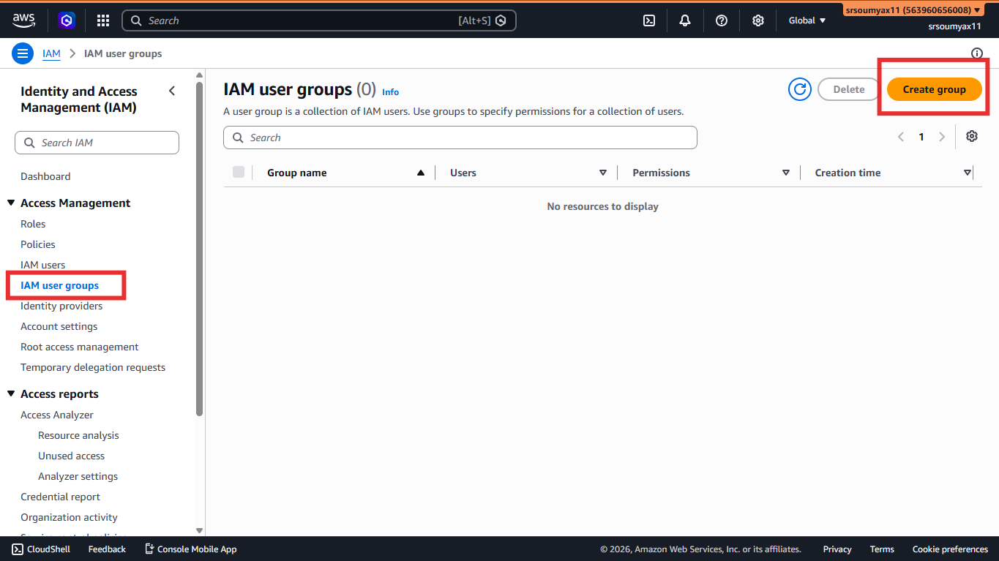
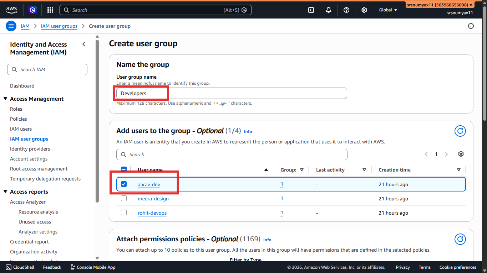
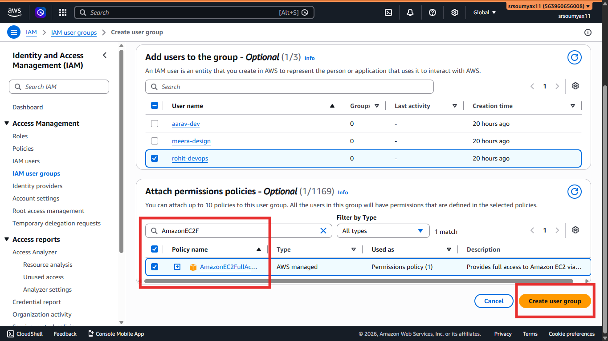
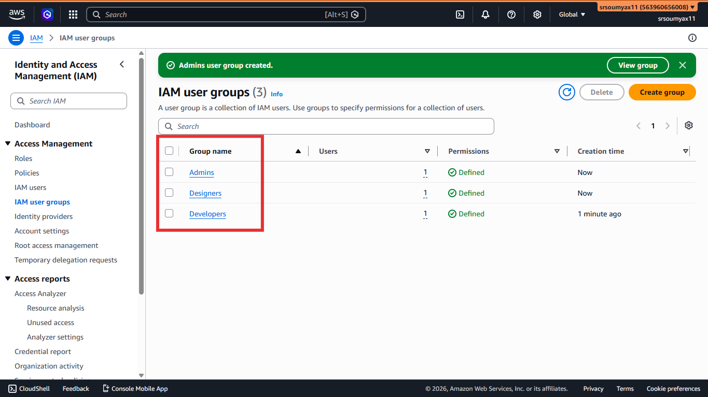
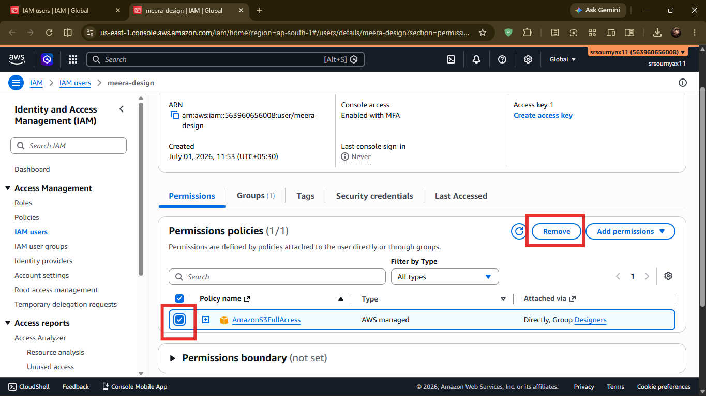

# Pixel & Spoon Hands-On: Creating and Managing IAM Groups 👥

> *Chapter 4.2 — Hands-on companion to Chapter 4: IAM: The Gatekeeper of AWS. In the last post, we gave Aarav, Meera, and Rohit their own IAM users. Today we fix the messy part — permissions managed properly through groups.*

---

## Where We Left Off

In Chapter 4.1, we created three IAM users for Pixel & Spoon's team:

- `aarav-dev` — backend developer
- `meera-design` — UI designer
- `rohit-devops` — DevOps engineer

We attached policies directly to each user — which worked, but it's not how real teams manage access.

Here's why that approach breaks quickly.

Next month, Pixel & Spoon hires a second backend developer. You'd have to remember exactly which policies Aarav has, then manually replicate them on the new hire. Then again for the third. Then again when you decide all developers need an extra permission — and now you have to update every single developer's user one by one.

That's not scalable. That's not even fun.

**IAM Groups** fix this completely.

---

## 🗂️ The Idea in One Sentence

Instead of managing permissions per person — manage them per role.

Create a **Developers** group. Attach the right policies to it. Add Aarav to it. Done. When the second developer joins, just add them to the same group — they instantly have identical access, zero extra config.

```
❌ Without Groups

   aarav-dev       →   EC2FullAccess (manually attached)
   new-developer   →   EC2FullAccess (manually remembered and attached)
   another-dev     →   EC2FullAccess (manually attached again...)

✅ With Groups

   Developers Group  →  EC2FullAccess (attached once)
        │
        ├── aarav-dev         (inherits automatically)
        ├── new-developer     (inherits automatically)
        └── another-dev       (inherits automatically)
```

One policy. One place to update. Everyone in the group stays in sync.

---

## 🛠️ Step-by-Step: Creating the Developers Group

We'll create three groups for Pixel & Spoon — Developers, Designers, and Admins. Let's do Developers first and walk through it fully.

---

**Step 1 — Open IAM**

In the AWS Console search bar, type `IAM` and open the IAM Dashboard.

---

**Step 2 — Go to User Groups**

On the left sidebar, click **User groups** — not "Users." It's just below it.

Click the orange **Create group** button.



---

**Step 3 — Name the Group**

For the group name, use:

```
Developers
```

Keep names simple, role-based, and capitalised for clarity. You'll thank yourself when you have 10 groups and need to scan through them quickly.

---

**Step 4 — Add Users to the Group**

Scroll down to the **"Add users to the group"** section. You'll see a list of your existing IAM users.

Tick the checkbox next to **aarav-dev**.

That's it for now — we'll add future developers here too when they join.



---


**Step 5 — Attach a Permission Policy**

Scroll further down to **"Attach permissions policies"**.

Search for:
```
AmazonEC2FullAccess
```

Tick it. This gives every member of the Developers group full access to EC2 — exactly what Aarav needs to build Pixel & Spoon's ordering backend.

> 💡 We're using `AmazonEC2FullAccess` for now because it's a clean AWS-managed policy that matches what Aarav's role requires at this stage. In Chapter 4.3, we'll look at writing tighter, custom policies when the default ones are too broad.

Click **Create group**.



---

## 🔁 Now Create the Other Two Groups

The process is identical — just different names, users, and policies.

---

**Designers Group**

| Field | Value |
|---|---|
| Group name | `Designers` |
| Add user | `meera-design` |
| Attach policy | `AmazonS3FullAccess` |

Meera needs S3 access to upload Pixel & Spoon's website assets, images, and frontend files. Nothing else.

---

**Admins Group**

| Field | Value |
|---|---|
| Group name | `Admins` |
| Add user | `rohit-devops` |
| Attach policy | `AdministratorAccess` |

Rohit is DevOps — he needs broad infrastructure access to keep everything running. `AdministratorAccess` is the most powerful AWS-managed policy. Treat group membership carefully here — only people who genuinely need full access belong in Admins.


---

## 🧹 Clean Up: Remove the Old Direct Policies

Remember in Chapter 4.1 we attached policies directly to each user as a temporary workaround?

Now that groups exist, those direct attachments are redundant — and having both can cause confusion later. Let's remove them.

**Step 1** — In IAM, go to **Users** → click `aarav-dev`.

**Step 2** — Click the **Permissions** tab. You'll see both the directly attached `AmazonEC2FullAccess` policy and the group-inherited one.

**Step 3** — Click the **X** next to the directly attached policy to remove it.

> If you donnt see the [x] button next to the directly attached, Remove the `AmazonEC2FullAccess` completly and then add the user again to the Developers Group. 


Aarav still has EC2 access — now cleanly inherited from the Developers group, not attached twice.

Repeat for `meera-design` (remove direct S3 policy) and `rohit-devops` (remove direct AdministratorAccess).




---

## ✅ What Pixel & Spoon Looks Like Now

```
🏢 Pixel & Spoon — AWS Account

👥 Developers Group   →  AmazonEC2FullAccess
        └── aarav-dev

👥 Designers Group    →  AmazonS3FullAccess
        └── meera-design

👥 Admins Group       →  AdministratorAccess
        └── rohit-devops

🔒 Root account       →  Locked away with MFA
```

Clean. Organised. Scalable.

When Pixel & Spoon hires its next backend developer, you open the Developers group, add their user, and walk away. They have exactly the right access in under 30 seconds.

When you need all developers to also access Lambda (which we'll need later in the series), you add the Lambda policy to the Developers group once — and every developer gets it instantly.

That's the power of managing permissions through groups.

>### 🛠️ Try It Yourself: Create a new user and add them to a group

Task: Pixel & Spoon just hired a second backend developer — Subham.
Goal: Create his IAM user and add him to the Developers group.

Steps:
1. Go to IAM → Users → Create user
   - Username: subham-dev
   - Enable console access
   - Custom password + force reset on first login

2. On the permissions screen → Add user to group → select "Developers"

3. Click Create user and save his sign-in details

✅ Done! Subham now has EC2 access automatically — no extra policy needed.


---

## 🗺️ Continue the Hands-On Series

**4.1** — ✅ Creating IAM Users

**4.2** — ✅ Creating and Managing IAM Groups *(you are here)*

**4.3** — Writing and Attaching IAM Policies

**4.4** — Creating IAM Roles: Human & Service

Next up — the policies we've been attaching are all AWS-managed defaults. In Chapter 4.3, we look under the hood at what those policies actually say, and write a simple custom one that gives Aarav exactly what he needs — and nothing more.

👉 **[Chapter 4.3: Writing and Attaching IAM Policies → (Read it here)](LINK)**

---

*Resources I'm learning from:*
- *[roadmap.sh/aws](https://roadmap.sh/aws) — my learning roadmap*
- *[AWS Official Overview Whitepaper](https://docs.aws.amazon.com/whitepapers/latest/aws-overview/introduction.html) — straight from the source*

---

*#aws #cloud #iam #handson*
