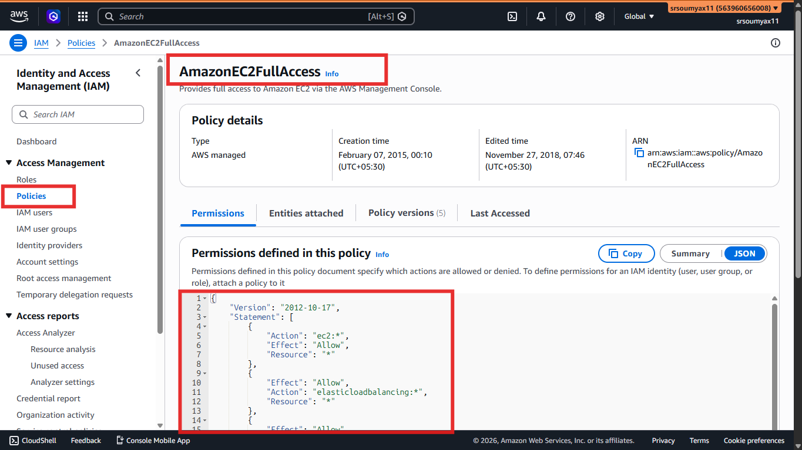
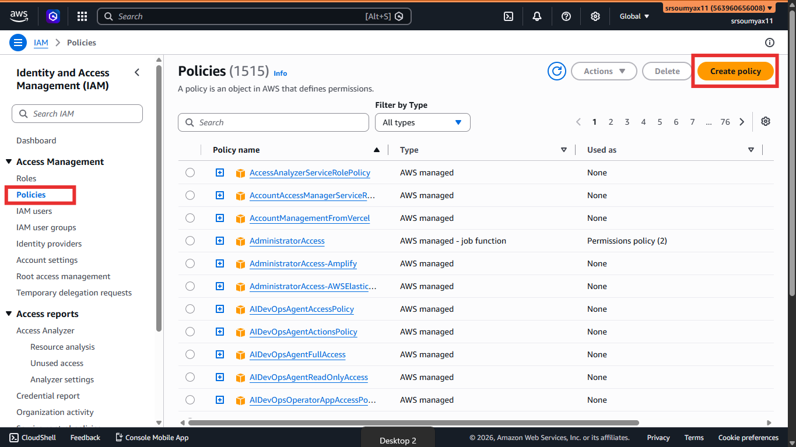
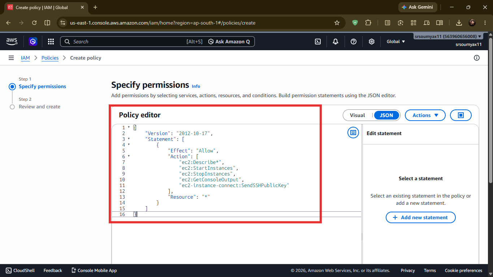
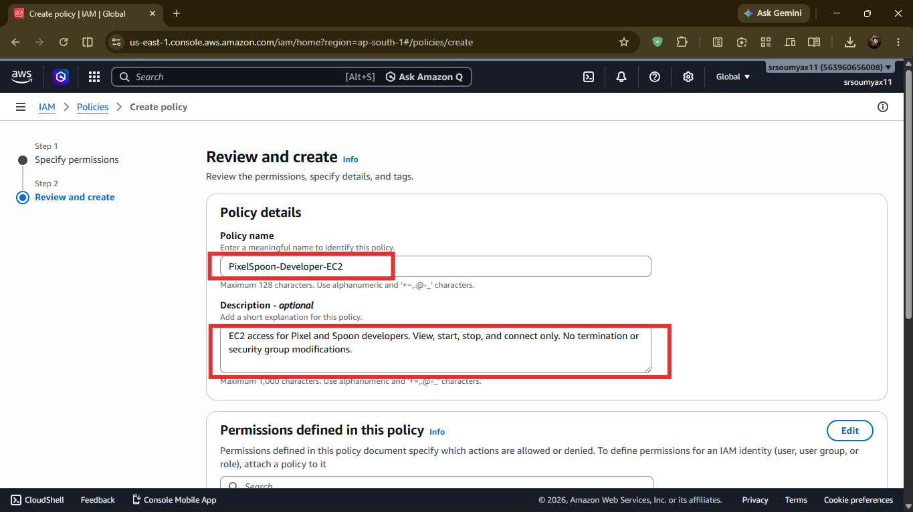
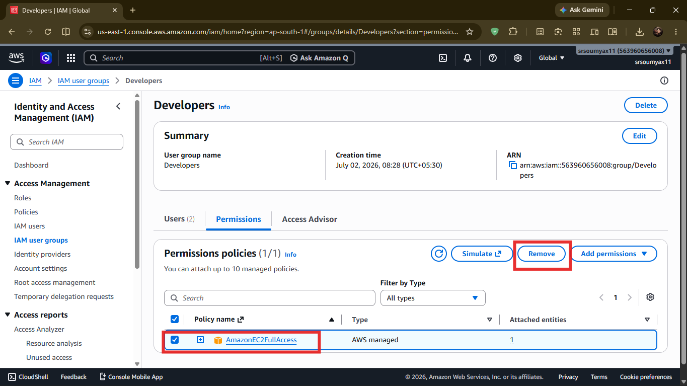
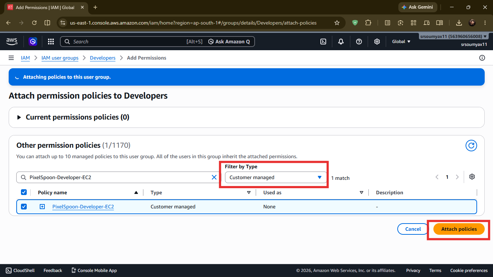
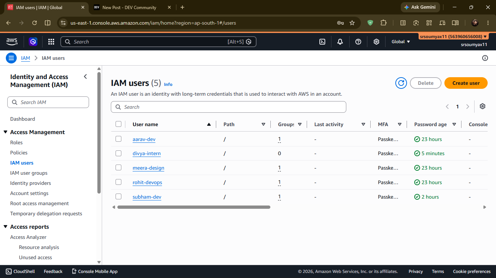

# Pixel & Spoon Hands-On: Writing and Attaching IAM Policies 📜

> *Chapter 4.3 — Hands-on companion to Chapter 4: IAM: The Gatekeeper of AWS. Aarav has EC2 access — but do we really know what that means? Today we open the policy, read what's inside, and write a tighter one.*

---

## The Policy We've Been Ignoring

In Chapter 4.1, we attached `AmazonEC2FullAccess` to Aarav.

In Chapter 4.2, we moved that to the Developers group.

But here's something we haven't done yet — actually looked at what `AmazonEC2FullAccess` allows.

Spoiler: it's a lot.

`AmazonEC2FullAccess` lets Aarav start instances, stop instances, terminate instances, create snapshots, modify security groups, allocate elastic IPs — essentially everything you can do with EC2.

Right now, Pixel & Spoon is a small startup. Aarav is trustworthy. It's fine.

But what happens when the team grows? What if you hire a junior developer who should only be able to *view* servers, not terminate them? Or a contractor who needs to start and stop instances, but never delete anything permanently?

AWS-managed policies like `AmazonEC2FullAccess` are broad by design — they cover everything in a service. **Custom policies** let you grant exactly what someone needs, nothing more.

That's what this chapter is about.

---

## 📜 What's Actually Inside a Policy?

Before we write one, let's read one.

In the AWS Console, search for `IAM` → click **Policies** in the left sidebar → search for `AmazonEC2FullAccess` → click on it → click the **JSON** tab.


You'll see something like this (simplified):

```json
{
  "Version": "2012-10-17",
  "Statement": [
    {
      "Effect": "Allow",
      "Action": "ec2:*",
      "Resource": "*"
    }
  ]
}
```

Let's read this in plain English:

```
"Version"    →  The policy language version. Always "2012-10-17". Don't change this.

"Statement"  →  A list of permission rules. One policy can have many statements.

"Effect"     →  "Allow" or "Deny". This one allows.

"Action"     →  What is being allowed. "ec2:*" means every EC2 action — all of them.

"Resource"   →  Which specific resources. "*" means all resources, no restrictions.
```

So `AmazonEC2FullAccess` in plain English says:

> *"Allow everything EC2 can do, on every resource, with no conditions."*

That's powerful. Too powerful for a junior developer.

---

## 🛠️ Step-by-Step: Creating a Custom Policy

Let's create a policy called `PixelSpoon-Developer-EC2` that gives Aarav only what he actually needs day-to-day:

- View all instances ✅
- Start and stop instances ✅
- Connect to instances ✅
- Terminate instances ❌ (too destructive — requires deliberate action)
- Modify security groups ❌ (that's Rohit's job)

---

**Step 1 — Open IAM → Policies**

Search `IAM` in the console → left sidebar → **Policies** → orange **Create policy** button.


---

**Step 2 — Switch to the JSON Editor**

At the top of the policy editor, click the **JSON** tab.

Clear what's there and paste in this custom policy:

```json
{
  "Version": "2012-10-17",
  "Statement": [
    {
      "Effect": "Allow",
      "Action": [
        "ec2:Describe*",
        "ec2:StartInstances",
        "ec2:StopInstances",
        "ec2:GetConsoleOutput",
        "ec2-instance-connect:SendSSHPublicKey"
      ],
      "Resource": "*"
    }
  ]
}
```

What each action does:

```
ec2:Describe*                        →  View/list any EC2 resource (instances, AMIs, etc.)
ec2:StartInstances                   →  Power on a stopped instance
ec2:StopInstances                    →  Power off a running instance
ec2:GetConsoleOutput                 →  Read the instance's console log for debugging
ec2-instance-connect:SendSSHPublicKey →  Connect via browser-based EC2 Instance Connect
```

> 💡 Notice `ec2-instance-connect` is a **separate service prefix** from `ec2` — it's easy to assume it lives under `ec2:` but AWS treats Instance Connect as its own service in IAM. This is a common mistake that causes "access denied" errors even when EC2 permissions look correct.

Notice what's **not** in the list — `ec2:TerminateInstances`, `ec2:AuthorizeSecurityGroupIngress`, `ec2:DeleteSnapshot`. Aarav simply can't do those things, even accidentally.




Click **Next**.

---

**Step 3 — Name and Describe the Policy**

```
Policy name:   PixelSpoon-Developer-EC2
Description:   EC2 access for Pixel and Spoon developers. View, start, stop, and connect only. No termination or security group modifications.
```

A good description matters — six months from now, you or someone else will look at this policy and need to understand what it does without decoding the JSON.

Click **Create policy**.



---

## 🔁 Attach the New Policy to the Developers Group

Now let's swap out `AmazonEC2FullAccess` from the Developers group and replace it with our tighter custom policy.

**Step 1** — Go to IAM → **User groups** → click **Developers**.

**Step 2** — Click the **Permissions** tab → click on the check box next to `AmazonEC2FullAccess` and click `Remove` to remove it.



**Step 3** — Click **Add permissions** → **Attach policies** → search for `PixelSpoon-Developer-EC2` → tick it → click **Attach policies**.

> Or you can filter by type **Customer managed** policies to find it faster.



Done. Aarav now has exactly what he needs — and nothing that could cause an incident at 2am.

---

## 🧠 AWS Managed vs Customer Managed — When to Use Which

Now that you've written one custom policy, here's a simple rule of thumb:

```
AWS Managed Policies
     ✅ Great for getting started quickly
     ✅ Maintained and updated by AWS
     ❌ Often broader than you actually need
     Use for: prototypes, personal learning, non-critical access

Customer Managed Policies
     ✅ Exactly the permissions you define
     ✅ Reusable across users, groups, and roles
     ✅ Auditable — you know exactly what's allowed
     ❌ Takes more time to write and maintain
     Use for: real teams, production environments, sensitive roles
```

At Pixel & Spoon, we'll keep `AdministratorAccess` on Rohit's Admins group for now — he's the only one in it and he genuinely needs broad access. But as the company grows, even that will get tightened.

---

## 🛠️ Try It Yourself

```
🛠️ Task: Write a read-only policy for Divya

Pixel & Spoon just brought on Divya as a data analytics intern.
She needs to VIEW EC2 instances and S3 buckets — but touch nothing.

Goal: Create a custom policy called PixelSpoon-Intern-ReadOnly
that allows only Describe/List/Get actions on EC2 and S3.

Hints:
- ec2:Describe* covers all EC2 viewing actions
- s3:GetObject, s3:ListBucket cover S3 read access
- Effect should be "Allow" on both
- Resource: "*" is fine for now

Then create an IAM user "divya-intern" and attach this policy directly
- remember to ad MFA
(she's temporary, so no group needed).
This is where IAM Role would be better, but we'll cover that in the next chapter.
```

```json
{
    "Version": "2012-10-17",
    "Statement": [
        {
            "Sid": "VisualEditor0",
            "Effect": "Allow",
            "Action": [
                "s3:GetObject",
                "ec2:Describe*",
                "s3:ListBucket"
            ],
            "Resource": "*"
        }
    ]
}
```




---

## 🗺️ Continue the Hands-On Series

**Ch 4.1** — ✅ Creating IAM Users

**Ch 4.2** — ✅ Creating and Managing IAM Groups

**Ch 4.3** — ✅ Writing and Attaching IAM Policies *(you are here)*

**Ch 4.4** — Creating IAM Roles: Human & Service

Next up — Karthik the auditor needs temporary access to Pixel & Spoon's AWS account. And the CI/CD bot needs to deploy code automatically without a human logging in. Both of these need Roles — not users, not groups.

👉 **[Chapter 4.4: Creating IAM Roles → (Read it here)](LINK)**

---

*Resources I'm learning from:*
- *[roadmap.sh/aws](https://roadmap.sh/aws) — my learning roadmap*
- *[AWS Official Overview Whitepaper](https://docs.aws.amazon.com/whitepapers/latest/aws-overview/introduction.html) — straight from the source*

---

*#aws #cloud #iam #handson*
