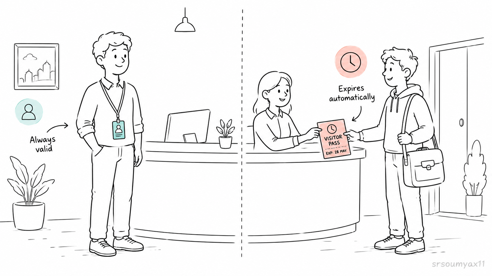
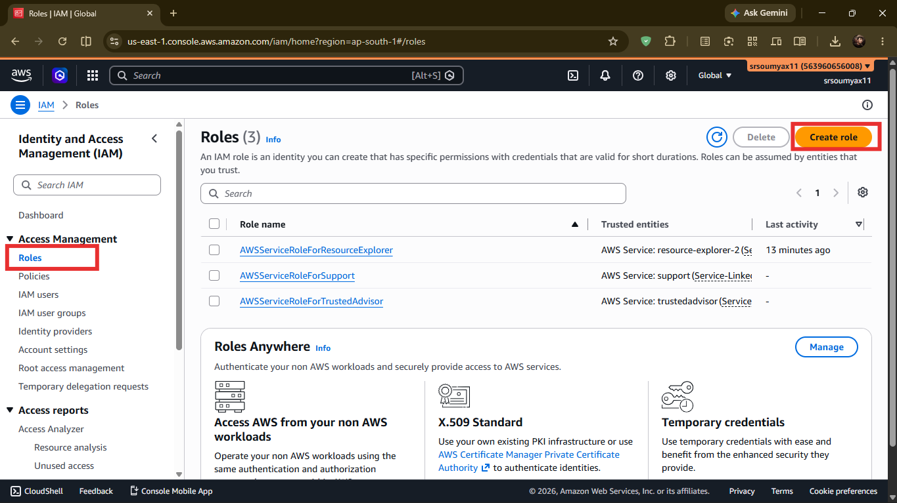
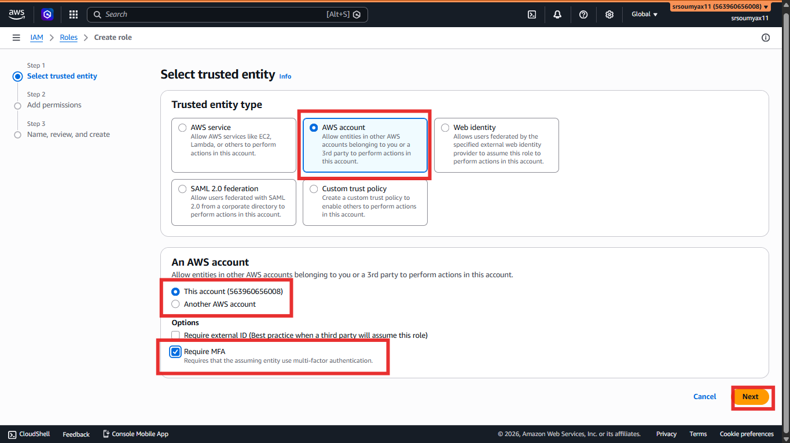
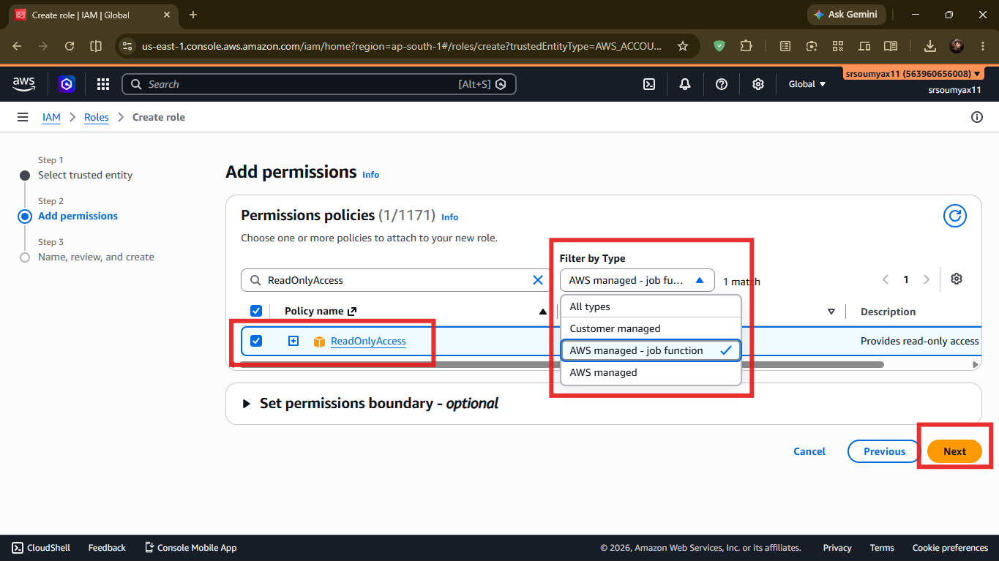
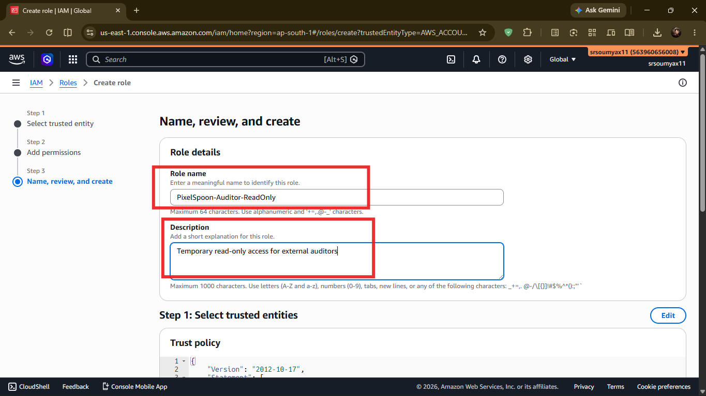
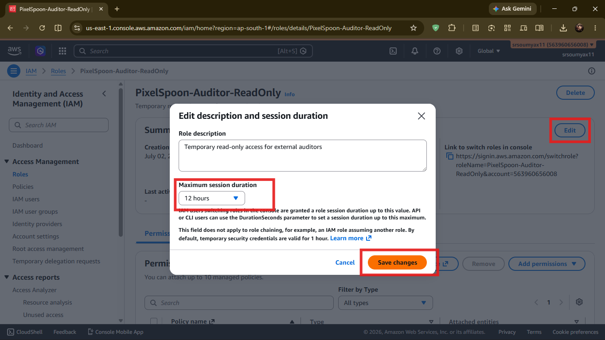
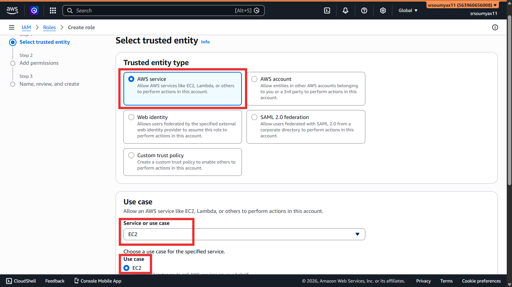
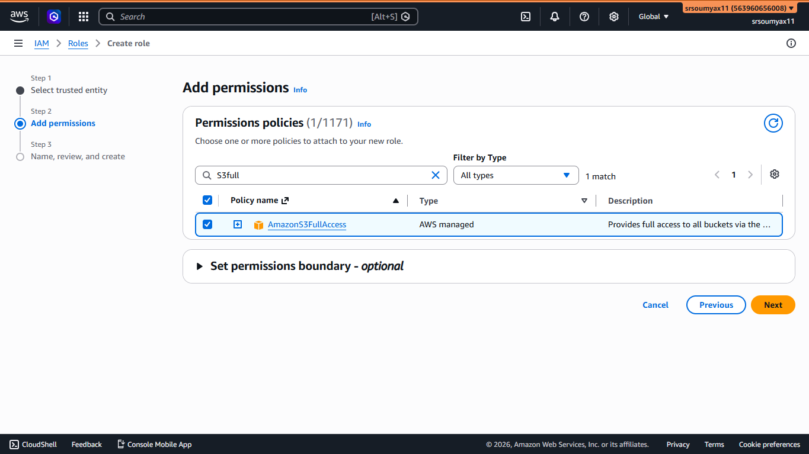

# Pixel & Spoon Hands-On: Creating IAM Roles 🎫

> *Chapter 4.4 — Hands-on companion to Chapter 4: IAM: The Gatekeeper of AWS. Users have logins. Groups have policies. But Karthik the auditor needs temporary access — and the CI/CD bot isn't even a human. Both need Roles.*

---

## The Problem Users Can't Solve

So far at Pixel & Spoon we have:

- Permanent IAM users for Aarav, Meera, Rohit, and Subham
- Groups that manage their permissions cleanly
- Custom policies with only what each role needs

But two situations just came up that users and groups can't handle well.

**Situation 1 — Karthik, the External Auditor**

Pixel & Spoon needs a compliance audit. Karthik is brought in for one week. He needs read-only access to review the AWS setup.

You *could* create an IAM user for him. But then what? After the audit, you have to remember to delete it. Miss that, and there's a dormant login sitting in your account indefinitely — a security risk with no benefit.

**Situation 2 — The CI/CD Bot**

Pixel & Spoon's deployment pipeline automatically pushes new code to AWS every time Aarav commits an update. This process needs AWS access to do its job.

But it's not a person. It can't log in with a username and password. Hardcoding AWS credentials into the deployment script is the worst possible option — if that script ever leaks, your entire account is exposed.

Both situations need the same solution: **IAM Roles**.

---

## 🎫 What Makes Roles Different

Think back to Chapter 4's office building analogy.

Users are permanent employees with ID badges that don't expire.

Roles are **visitor passes** — temporary credentials issued for a specific purpose, that expire automatically, and can be assumed by whoever needs them at that moment.



```
👤 IAM User     →  Permanent identity, long-term credentials
                   Belongs to one specific person or system

🎫 IAM Role     →  Temporary identity, short-lived credentials
                   Can be assumed by users, services, or other accounts
                   Expires automatically — no cleanup needed
```

No hardcoded passwords. No forgotten logins. Clean, auditable, automatic.

---

## 🛠️ Part 1: Creating a Role for Karthik (Human Temporary Access)

We'll create a role that Karthik can assume for half a day, giving him read-only access to review Pixel & Spoon's setup.

---

**Step 1 — Open IAM → Roles**

Search `IAM` in the console → left sidebar → **Roles** → orange **Create role** button.



---

**Step 2 — Choose Trusted Entity Type**

You'll see four options for who can assume this role:

```
○ AWS service
     An AWS service like EC2 or Lambda assumes the role automatically.
     Used when your own infrastructure needs to talk to other AWS services.
     Example: a server that uploads files to S3 without hardcoded passwords.

○ AWS account          ← Karthik's option
     A person or system from another AWS account assumes the role.
     Used for external collaborators, auditors, or cross-team access.
     Example: Karthik logging in from his own company's AWS account.

○ Web identity
     Users who sign in via Google, Facebook, Amazon Cognito, etc.
     Used for mobile or web apps where end users need temporary AWS access.
     Example: a user logs into your app with Google and gets access to their own S3 folder.

○ SAML 2.0 federation
     Employees who sign in via a company identity system (like Okta or Active Directory).
     Used by large organisations that already have their own login infrastructure.
     Example: all 500 employees at a company use their work email to access AWS — no separate IAM users needed.
```

Karthik is from an external company with their own AWS account. Select **AWS account**.

Enter **"Another AWS account"** and type in Karthik's company AWS account ID.

> 💡 If Karthik doesn't have an AWS account, choose "This account" instead and you'll let him switch into the role from a temporary IAM user you create. For now we'll assume he has his own account.

Tick **"Require MFA"** — this means even after assuming the role, Karthik must have MFA active. Good practice for any external access.

Click **Next**.




---

**Step 3 — Attach a Permission Policy**

Search for and select:

```
ReadOnlyAccess
```

This is an AWS-managed policy that gives read-only access across all AWS services — Karthik can look at everything but change nothing. Perfect for an audit.

If You can not find it, Select `AWSManaged - job-function` Filter and then search for `ReadOnlyAccess`.



Click **Next**.

---

**Step 4 — Name the Role**

```
Role name:   PixelSpoon-Auditor-ReadOnly
Description: Temporary read-only access for external auditors.
             Requires MFA. Maximum session 12hours.
```

Click **Create role**.



---

**Step 5 — Set the Maximum Session Duration**

Click into the role you just created → **Edit** next to "Maximum session duration" → set it to **12 hours** (the maximum AWS allows for role sessions).

This means Karthik's assumed session automatically expires after 12 hours. No manual cleanup required.



---

**Step 6 — Share the Role ARN with Karthik**

On the role summary page, copy the **Role ARN** — it looks like:

```
arn:aws:iam::563960656008:role/PixelSpoon-Auditor-ReadOnly
```

Send this to Karthik. He uses it to "switch roles" inside his own AWS console — his credentials stay his own, but he temporarily gains your role's permissions for the duration of the audit.

When the time is over, his session expires. Nothing to delete. Nothing to forget.

---

## 🤖 Part 2: Creating a Service Role for the CI/CD Bot

Now for the trickier one — the deployment bot.

This isn't a human assuming a role. It's an **AWS service** (in this case, we'll use EC2 as the example, since the bot runs on a server) that needs permission to deploy code to other AWS services.

---

**Step 1 — Create Role → AWS Service**

IAM → Roles → **Create role** → select **AWS service**.

Under "Service or use case," select **EC2**.

This tells AWS: "I want to create a role that an EC2 instance can assume."

Click **Next**.



---

**Step 2 — Attach the Right Policy**

The CI/CD bot needs to deploy code — which in Pixel & Spoon's case means pushing files to S3 and triggering deployments. Search for and attach:

```
AmazonS3FullAccess
```

For a real deployment pipeline you'd write a tighter custom policy (Least Privilege again), but for this walkthrough this gets us moving.

Click **Next**.



> 🤔 **"Wait — why S3? Can't we just store the code directly on EC2?"**
>
> Quick context before we answer — if these terms are new to you:
>
> **EC2** is a virtual server on AWS — the machine that runs your code.
> Think of it as a computer in the cloud. We cover it fully in Chapter 5.
>
> **S3** is AWS's storage service — like a hard drive in the cloud that
> exists independently of any server. We cover it fully in Chapter 8.
>
> Now — back to the question.
>
> Yes, you *can* store deployment files directly on EC2. In simple
> setups, people do exactly that.
>
> But here's the problem:
>
> EC2 instances can be stopped, replaced, or terminated at any time —
> especially once we add Auto Scaling in Chapter 6. When that happens,
> everything stored locally on that instance is gone.
>
> S3 lives outside any single server. Your files sit there safely,
> and it doesn't matter how many EC2 instances come and go —
> the files are always available.
>
> Think of it like this:
>
> EC2 is the chef. S3 is the pantry.
> You don't store the ingredients inside the chef.
>
> We'll cover both properly in their own chapters — for now,
> just know this is exactly the kind of problem S3 was built to solve.

---

**Step 3 — Name the Role**

```
Role name:   PixelSpoon-CICD-DeployRole
Description: Service role for CI/CD deployment bot.
             Assumed by EC2. Allows S3 deploy access.
```

Click **Create role**.

---

**Step 4 — Attach the Role to Your EC2 Instance**

When you launch the EC2 instance that runs the deployment bot (we'll do this properly in Chapter 5), there's an option called **IAM instance profile** — this is where you select `PixelSpoon-CICD-DeployRole`.

The instance then automatically receives temporary, rotating credentials for this role. No passwords. No access keys stored in code. AWS handles credential rotation completely.

```
🤖 CI/CD Bot (EC2 instance)
        │
        │  assumes role automatically
        ↓
🎫 PixelSpoon-CICD-DeployRole
        │
        │  grants permission to
        ↓
🪣 S3 Bucket  →  deploys files
```

This is considered the gold standard for giving AWS services access to other AWS services. You'll see this pattern everywhere as the series progresses.


---

## ✅ Where Pixel & Spoon Stands Now

The IAM setup is complete. Here's the full picture:

```
🏢 Pixel & Spoon — AWS Account

🔒 Root account          →  Locked with MFA. Used for emergencies only.

👥 Developers Group      →  PixelSpoon-Developer-EC2 policy
        └── aarav-dev
        └── subham-dev

👥 Designers Group       →  AmazonS3FullAccess
        └── meera-design

👥 Admins Group          →  AdministratorAccess
        └── rohit-devops

👤 divya-intern          →  PixelSpoon-Intern-ReadOnly (direct attach, temp)

🎫 PixelSpoon-Auditor-ReadOnly    →  For Karthik, expires in 12 hours
🎫 PixelSpoon-CICD-DeployRole     →  For the deployment bot, assumed by EC2
```

Every identity has exactly the access it needs. Nothing more.

That's Least Privilege — applied end to end across a real team.

---

## 🗺️ Continue the Hands-On Series

**Ch 4.1** — ✅ Creating IAM Users

**Ch 4.2** — ✅ Creating and Managing IAM Groups

**Ch 4.3** — ✅ Writing and Attaching IAM Policies

**Ch 4.4** — ✅ Creating IAM Roles: Human & Service *(you are here)*

The IAM arc is complete. Pixel & Spoon's account is secured, organised, and ready to actually build something.

Aarav has been waiting patiently. It's time to give him a server.

👉 **[Chapter 5: EC2 — Your First Server in the Cloud → (Read it here)](LINK)**

---

*Resources I'm learning from:*
- *[roadmap.sh/aws](https://roadmap.sh/aws) — my learning roadmap*
- *[AWS Official Overview Whitepaper](https://docs.aws.amazon.com/whitepapers/latest/aws-overview/introduction.html) — straight from the source*

---

*#aws #cloud #iam #role*