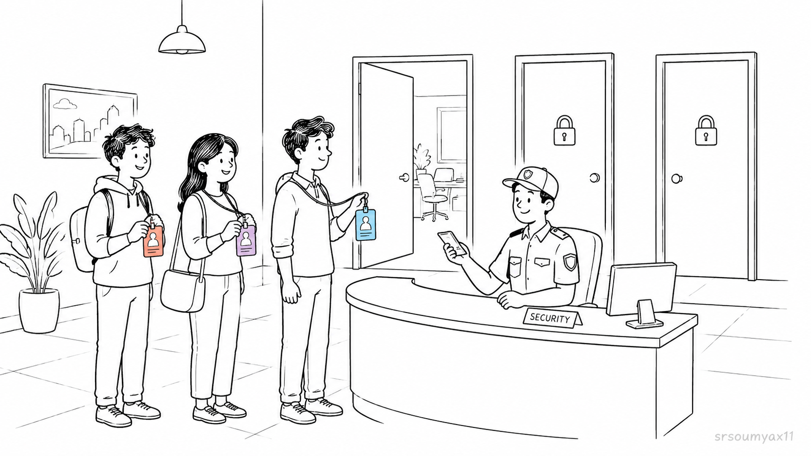
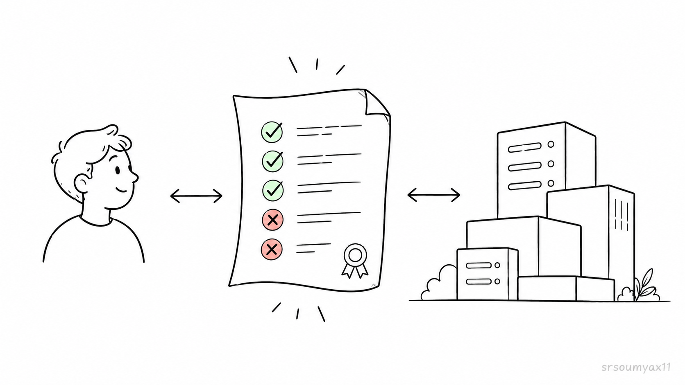
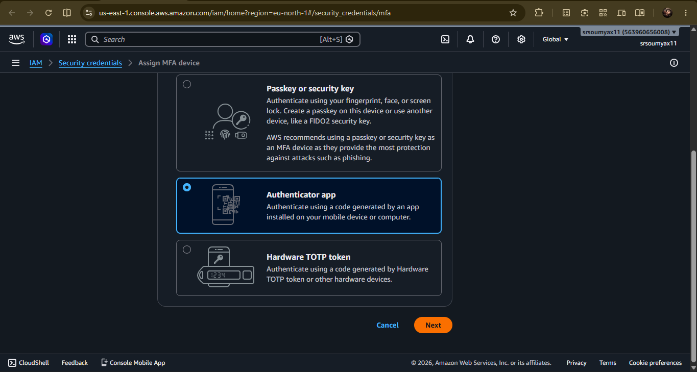
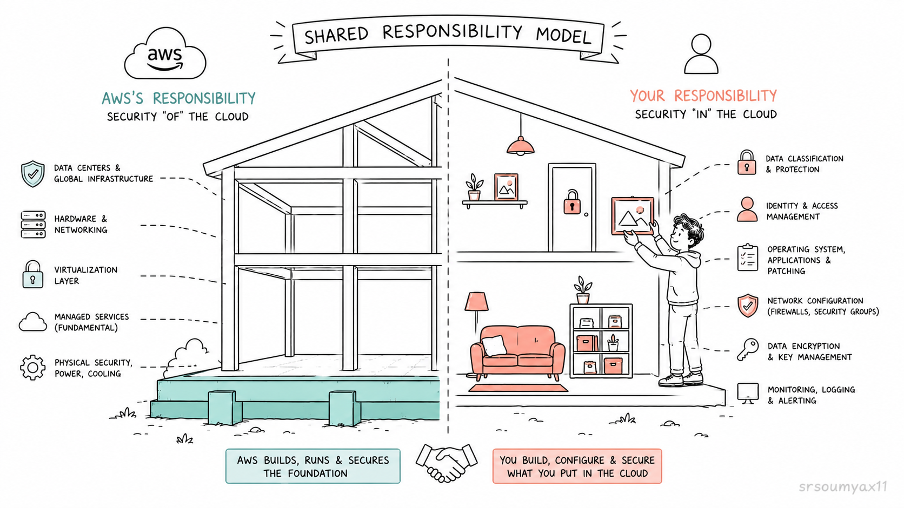

# IAM: The Gatekeeper of AWS 🔐

> *Chapter 4 of the AWS Learning Journey. Meet Pixel & Spoon — the startup we'll be building alongside for the rest of this series. Today, we secure their AWS account before anything else gets built.*

---

## Meet Pixel & Spoon 🍱

Remember the food app idea from Chapter 0?

Let's actually build it.

Say hello to **Pixel & Spoon** — a small food-delivery startup. Order home-cooked meals from local cooks, delivered to your door. You're the founder.

It's early days. Right now it's just you and your AWS account, fresh out of Chapter 3, fully set up, billing alert active.

But you're about to hire your first team.

**Aarav** joins as your backend developer — he'll build the ordering system.
**Meera** joins as your UI designer — she'll build the website people see.
**Rohit** joins as your DevOps engineer — he'll keep the servers running.

It's day one. Everyone needs access to AWS to do their jobs.

So... what do you do?

Hand them your root account password?

Let's talk about why that would be a terrible idea.

---

## 🗝️ The Master Key Problem

Your root account — the one you created in Chapter 3 — isn't just powerful. It's **all-powerful**.

It can launch servers. Delete servers. Change billing. Close the entire AWS account. Access every single service, every single resource, with zero restrictions.

Now imagine giving that same password to Aarav, Meera, and Rohit.

Aarav only needs to write code and launch servers. But now he can also delete your billing information.

Meera only needs to upload images. But now she can also shut down the database.

If any one of their laptops gets compromised, or any one of them accidentally clicks the wrong button — your entire company's infrastructure is at risk.

```
🗝️  Root Account = Master Key

   Opens: Every door. Every room. The vault. The server room.
          The CEO's office. Everything.

   Given to: Everyone on the team, "just to be safe"

   Result: One mistake, one stolen laptop, one phishing email —
            and the entire building is compromised
```

This is exactly why companies don't run on root accounts.

This is exactly why **IAM** exists.

---

## 🛡️ What Is IAM?

**IAM** stands for **Identity and Access Management**.

Think of it as the security desk at Pixel & Spoon's office building.

Nobody walks straight into the server room. Everyone checks in at the front desk first. They get an ID badge. That badge only opens the doors they're actually supposed to access.

The marketing intern's badge doesn't open the server room.
The developer's badge doesn't open the finance office.
The cleaning staff's badge works after hours, but only for common areas.

That's IAM, in one sentence: **it controls who can do what inside your AWS account.**



Instead of handing out the master key, you create separate identities — one for each person — with only the access they actually need to do their job.

---

## 👤 IAM Users — Giving Everyone Their Own Badge

The first thing you do as Pixel & Spoon's founder is create **IAM users** for your team.

An IAM user is an identity inside your AWS account — their own username, their own password, their own access keys if they need programmatic access.

You create one for Aarav. One for Meera. One for Rohit.

Each one logs in separately. Each one's actions are tracked separately. If something goes wrong, you know exactly whose badge was used.

```
🏢  Pixel & Spoon's AWS Account

     👤 Aarav    →  IAM user "aarav-dev"
     👤 Meera    →  IAM user "meera-design"
     👤 Rohit    →  IAM user "rohit-devops"

     🔒 Root account →  Locked away, used only in emergencies
```

This alone is a massive security improvement. But we're not done — because creating three separate users with three separate sets of permissions, one by one, doesn't scale. What happens when Pixel & Spoon hires a second developer next month?

> [🛠️ Hands-on: Ready to actually create Aarav's, Meera's, and Rohit's IAM users? Follow along in Chapter 4.1 — Creating Your First IAM Users (Step by Step)]()


---

## 👥 IAM Groups — Badges That Come in Batches

This is where **Groups** come in.

Instead of configuring permissions individually for every person, you create a group — say, "Developers" — set the permissions once, and add people to it.

Aarav joins the Developers group. He instantly gets exactly the access a developer needs — EC2, Lambda, and related services.

Next month, Pixel & Spoon hires a second backend developer. You add them to the same Developers group. Done. Same permissions, zero extra configuration.

```
👥  Developers Group
     Permissions: EC2 (launch/manage servers), Lambda (deploy functions)
     Members: Aarav, [future developer hire]

👥  Designers Group
     Permissions: S3 (upload assets), Amplify (deploy frontend)
     Members: Meera

👥  Admins Group
     Permissions: Full infrastructure access
     Members: Rohit
```

Groups are how real companies manage access at scale. You're not thinking "what does this one person need" every time — you're thinking "what does this *role* need," and people simply join the group that matches their role.

> [🛠️ Hands-on: Want to set up the Developers, Designers, and Admins groups for real? That's covered in Chapter 4.2 — Creating and Managing IAM Groups.]()


---

## 📜 IAM Policies — The Actual Rulebook

So far we've said things like "Aarav gets EC2 access" — but how does AWS actually know what that means?

That's what a **Policy** is.

A policy is a document — written in JSON — that explicitly states what's allowed and what's denied. Every permission in IAM ultimately comes down to a policy attached to a user, a group, or a role.

Here's a simplified look at what a policy for the Developers group might say:

```json
{
  "Effect": "Allow",
  "Action": [
    "ec2:StartInstances",
    "ec2:StopInstances",
    "ec2:DescribeInstances"
  ],
  "Resource": "*"
}
```

In plain English: *"Allow this group to start, stop, and view EC2 instances. Nothing else."*

Aarav can launch and manage servers. He cannot touch billing. He cannot delete IAM users. He cannot access Meera's S3 buckets unless explicitly permitted.

AWS also provides ready-made policies for common roles — so you rarely write these from scratch as a beginner. But understanding that every permission traces back to a policy document is what makes IAM click.

> [🛠️ Hands-on: Curious how to attach a real policy — or write a simple custom one? Walk through it in Chapter 4.3 — Writing and Attaching IAM Policies.]()



---

## 🎫 IAM Roles — The Visitor Badge That Expires

Now here's a trickier situation.

Pixel & Spoon hires **Karthik**, an external auditor, to review their AWS setup for a compliance check. He needs temporary access — just enough to look around, for just a few days.

You wouldn't create a permanent IAM user for someone who'll never log in again after next week. That's a badge nobody remembers to deactivate, sitting around as a security risk months later.

This is exactly what **IAM Roles** are for.

A role is temporary access — like a visitor badge at the front desk. It's issued when needed, has an expiry, and doesn't belong to any one permanent identity.

Roles aren't just for humans, either.

Pixel & Spoon also has a **CI/CD bot** — an automated system that deploys new code every time Aarav pushes an update. It's not a person. It can't "log in" with a username and password. Instead, it assumes a role — temporary credentials that let it do exactly its job (deploy code) and nothing else, refreshed automatically each time it runs.

```
🎫  IAM Role Examples at Pixel & Spoon

     Karthik (Auditor)  →  Temporary role, expires after 7 days
     CI/CD Bot          →  Service role, auto-refreshed credentials
     Rohit (on-call)    →  Can "assume" an emergency admin role
                            only during incidents, logged every time
```

This is also how different AWS services talk to each other securely — an EC2 instance can assume a role that lets it read from an S3 bucket, without anyone hardcoding a password anywhere. We'll see this in action when we reach EC2 and S3 later in the series.

> [🛠️ Hands-on: See how to create a temporary role for someone like Karthik, or a service role for the CI/CD bot, in Chapter 4.4 — Creating IAM Roles (Human & Service).]()

---

## 🔒 MFA — Locking the Front Door Properly

One more critical step before we move on.

Even with IAM users and groups set up properly, your **root account** still exists. And if someone gets your root password — through phishing, a data breach, or simple guessing — they have full control of Pixel & Spoon's entire AWS account.

This is where **Multi-Factor Authentication (MFA)** comes in.

MFA means logging in requires two things: your password, and a temporary code generated by an app on your phone (like Google Authenticator or Authy). Even if someone steals your password, they can't get in without your physical phone too.

**Setting up MFA on your root account — do this right now:**

**Step 1** — Log in to the AWS console with your root user.

**Step 2** — Search for "IAM" in the top search bar and open it.

**Step 3** — On the IAM dashboard, you'll see a security recommendation to "Add MFA for root user." Click it.

**Step 4** — Choose "Authenticator app," scan the QR code with Google Authenticator or Authy, and enter the two consecutive codes it generates.

**Step 5** — Done. Your root account now requires your phone to log in, not just a password.

Do this for every IAM user too, especially anyone with elevated permissions — Rohit, in Pixel & Spoon's case, should absolutely have MFA enabled.



> [🛠️ Hands-on: This one's already a full walkthrough above — but if you'd like a version with screenshots for every click, check Chapter 4.5 — MFA Setup with Screenshots.]()


---

## ☂️ The Shared Responsibility Model

There's one more concept that ties everything in this chapter together — and it's one of the most commonly misunderstood ideas in cloud computing.

**Who is actually responsible for security on AWS — Amazon, or you?**

The answer is: **both**. Just different parts.

This is called the **Shared Responsibility Model**.

```
☁️  AWS is responsible for security OF the cloud:

     🏢  Physical data centers
     🔌  Networking infrastructure
     🖥️  The hardware running everything
     ⚡  Power, cooling, physical security of buildings

🧑‍💻  You are responsible for security IN the cloud:

     🔑  Who has access (IAM — this entire chapter)
     📂  How your data is configured and encrypted
     🔥  Firewall and security group rules
     🔓  Whether your S3 bucket is accidentally public
```

AWS will never accidentally leave your S3 bucket public. You might, if you misconfigure it.

AWS will never let an unauthorized person walk into their data center. But if you give Aarav root access "just to make things easier," and his laptop gets compromised — that's on your side of the responsibility line.



This single idea — knowing where AWS's job ends and yours begins — is the foundation of every security decision you'll make for the rest of this series.

---

## 🧩 Where Pixel & Spoon Stands Now

Let's recap what just happened at Pixel & Spoon.

The root account is locked away with MFA, used only for emergencies.

Aarav, Meera, and Rohit each have their own IAM user, grouped by role, with only the permissions their job actually requires.

Karthik gets temporary, expiring access through a role — not a permanent login.

The CI/CD bot deploys code automatically using a service role — no hardcoded passwords anywhere.

And everyone on the team — including you, the founder — now understands exactly where AWS's responsibility ends and Pixel & Spoon's begins.

This is the foundation every real AWS setup is built on. Skipping this chapter is how companies end up in security breach headlines.

---

## 🗺️ Where We Go From Here

**Ch 00** — ✅ The origin story 

**Ch 01** — ✅ The world before AWS

**Ch 02** — ✅ Virtualization & Cloud Models

**Ch 03** — ✅ Welcome to AWS

**Ch 04** — ✅ IAM: The Gatekeeper of AWS *(you are here)*

**Ch 05** — EC2: Your First Server in the Cloud

**Ch 06** — EBS, AMI & Auto Scaling: The Complete Compute Picture

**Ch 07** — AWS CLI: Stop Clicking, Start Typing

**Ch 08** — S3: Store Anything, Forever

**Ch 09** — Databases on AWS: RDS & DynamoDB

**Ch 10** — Serverless: Lambda, SNS & SQS

**Ch 11** — Monitoring & Secrets: CloudWatch + Secrets Manager

**Ch 12** — Networking: Route 53, CloudFront & VPC

**Ch 13** — Infrastructure as Code: CloudFormation & Terraform

**Ch 14** — Containers: ECS & EKS

**Ch 15** — Billing & Pricing: Never Get a Surprise Bill

**Ch 16** — Capstone: Build a Full Stack App on AWS

**Ch 17** — AWS vs Azure vs GCP: An Honest Comparison

**Ch 18** — What's Next: The AWS Certifications Roadmap

---

### Before You Click Away.

The building is secure. The badges are issued. The front desk is staffed.

But before Pixel & Spoon builds anything — Aarav, Meera, and Rohit need their actual logins set up inside AWS.

Ready to do it yourself, step by step?

🛠️ **Hands-on companion posts for this chapter:**

👉 **[Ch 4.1 — Creating IAM Users → (Read it here)](LINK)**

👉 **[Ch 4.2 — Creating and Managing IAM Groups → (Read it here)](LINK)**

👉 **[Ch 4.3 — Writing and Attaching IAM Policies → (Read it here)](LINK)**

👉 **[Ch 4.4 — Creating IAM Roles: Human & Service → (Read it here)](LINK)**


Once the team is set up — it's time to actually build something.

Aarav has been waiting since the start of this chapter to write code 
for the ordering system. But code needs somewhere to run.

In Chapter 5, we hand Aarav his first server — and you'll launch your 
very first EC2 instance right alongside him.

This is the chapter where AWS stops being theory.

👉 **[Chapter 5: EC2 — Your First Server in the Cloud → (Read it here)](LINK)**
---

*Resources I'm learning from:*
- *[roadmap.sh/aws](https://roadmap.sh/aws) — my learning roadmap*
- *[AWS Official Overview Whitepaper](https://docs.aws.amazon.com/whitepapers/latest/aws-overview/introduction.html) — straight from the source*

---

*#aws #cloud #iam #security*
