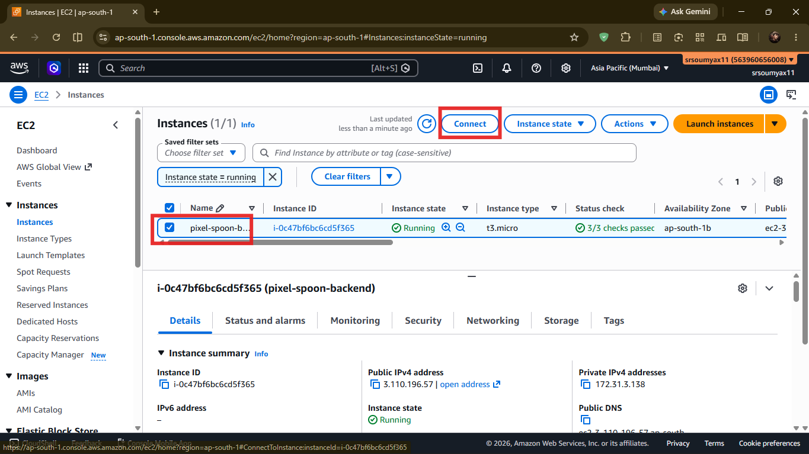
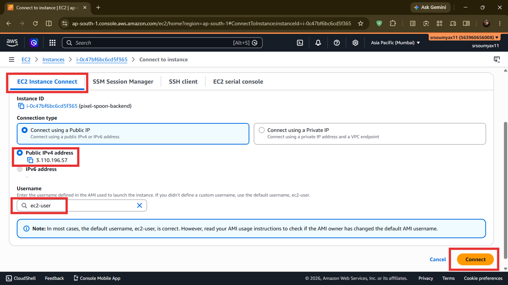
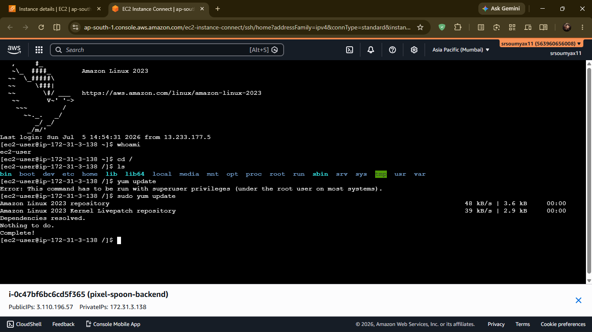

# Pixel & Spoon Hands-On: Connecting to Your EC2 Instance 🔌

> *Chapter 5.1 — Hands-on companion to Chapter 5: EC2 — Your First Server in the Cloud. Your instance is running. Now let's actually get inside it.*

---

## Four Doors, One Server

When Aarav clicks the **Connect** button on his running EC2 instance, AWS shows him something that surprises most beginners.

Not one way to connect. **Four.**

```
○ EC2 Instance Connect
○ Session Manager
○ SSH Client
○ EC2 Serial Console
```

Each one is a different door into the same server. Different requirements, different use cases, different levels of security.

Pick the wrong one and you'll spend 20 minutes wondering why it isn't working.

Let's go through each one — what it is, when to use it, and how.

---

## 🚪 Door 1 — EC2 Instance Connect ✅ Start Here

**What it is:**
Connect directly from your browser. No terminal. No key file. No software to install. AWS handles authentication automatically.

**Requirements:**
```
✅ Amazon Linux 2023 or Ubuntu (which we're using)
✅ Instance must have a public IP
✅ Port 22 open in your security group
```

**How to connect:**

**Step 1** — In the EC2 console, select your instance → click the **Connect** button at the top.


**Step 2** — Make sure you're on the **EC2 Instance Connect** tab.

**Step 3** — Username should already say `ec2-user` — leave it as is.

**Step 4** — Click **Connect**.


A terminal opens right in your browser. You're inside Aarav's server.


**Best for:** Beginners, quick access, one-off tasks, anyone who doesn't want to deal with key files right now.

This is what we recommend for following along with this series.

## Some basic commands you can try on it

```
# Check the OS version
cat /etc/os-release

# Check the hostname
hostname

# Check the current user
whoami

# Check the current directory
pwd

# List files in the current directory
ls -la

# resource usage
top

```

---

## 🚪 Door 2 — SSH Client — The Classic Way

**What it is:**
Connect from your own terminal using the `.pem` key file you downloaded when launching the instance. More control, works from anywhere, preferred by most developers once they get comfortable.

**Requirements:**
```
✅ Your pixelspoon-key.pem file (downloaded in Ch 05)
✅ Terminal — Mac/Linux uses built-in Terminal
              Windows uses PowerShell or PuTTY
✅ Port 22 open in security group
```

**How to connect:**

**Step 1** — Open your terminal and navigate to where your `.pem` file is saved.

**Step 2** — Set the correct permissions on the key file:

```bash
chmod 400 pixelspoon-key.pem
```

> 💡 `chmod 400` makes the file read-only for you, and blocks access for everyone else. SSH refuses to run if your private key can be read by other users on your machine — it's a deliberate security check. Skip this step and you'll get a "WARNING: UNPROTECTED PRIVATE KEY FILE" error.

**Step 3** — Connect using your instance's public IP:

```bash
ssh -i "pixelspoon-key.pem" ec2-user@YOUR_PUBLIC_IP
```

Find your public IP in the EC2 console — it's listed under **Public IPv4 address** on your instance details page. In Aarav's case: `3.110.196.57`.

So his command looks like:

```bash
ssh -i "pixelspoon-key.pem" ec2-user@3.110.196.57
```

**Step 4** — The first time you connect, SSH will ask:

```
Are you sure you want to continue connecting (yes/no/[fingerprint])?
```

Type `yes` and press Enter. This is normal — SSH is verifying the server's identity for the first time.


**Best for:** Developers who prefer working in their own terminal, automation scripts, repeated connections.

---

## 🚪 Door 3 — SSM Session Manager — No Open Ports

**What it is:**
Connect without opening port 22 at all. AWS Systems Manager creates a secure tunnel through AWS's own internal network — your connection never touches the public internet.

**Requirements:**
```
✅ SSM Agent installed (pre-installed on Amazon Linux 2023)
✅ IAM role with SSM permissions attached to the instance
✅ No open ports needed — not even port 22
```

**Why this matters:**

Every open port is a potential attack surface. Port 22 is the most targeted port on the internet — bots scan for it constantly and attempt brute force logins 24/7.

SSM Session Manager eliminates that attack surface entirely. No port open, nothing to scan, nothing to brute force.

This is the connection method used in production environments by teams that take security seriously.

**How to set it up:**

For SSM to work, your EC2 instance needs an IAM role with the `AmazonSSMManagedInstanceCore` policy attached. Remember IAM roles from Chapter 4.4? This is exactly that pattern — a service role for EC2.

We'll set this up properly in Chapter 6 when we cover IAM roles for EC2 instances. For now — know it exists, know it's the professional standard, and come back to it then.

**Best for:** Production servers, instances without public IPs, security-conscious setups, teams that want zero open ports.

---

## 🚪 Door 4 — EC2 Serial Console — The Emergency Exit

**What it is:**
Connects at the hardware level, bypassing the operating system entirely. Works even when the OS won't boot, the network is down, or the instance is completely unresponsive.

**Requirements:**
```
✅ Must be enabled at the AWS account level first
✅ Password-based auth must be configured on the instance
```

**When you'd use it:**

You won't need this often. Hopefully never.

But imagine this: Aarav pushes a bad config change that breaks networking on the server. The instance is running, but SSH times out, Instance Connect fails, SSM can't reach it. Everything is broken.

The Serial Console is the emergency override — the master key that works when all the normal doors are locked. It connects before the OS even finishes loading.

**Best for:** Debugging broken instances, recovering from misconfigurations, instances that won't respond to anything else.

---

## 🧭 Which One Should You Use?

```
Just starting out / following this series   →  EC2 Instance Connect
Prefer your own terminal environment        →  SSH Client
Production server, security-first           →  SSM Session Manager
Instance is broken and won't respond        →  EC2 Serial Console
```

For Pixel & Spoon right now — **EC2 Instance Connect**. Zero setup, works immediately, gets you inside in under 30 seconds.

---

## ✅ Once You're Connected

Whichever door you used, you'll land here:

```
   ,     #_
   ~\_  ####_        Amazon Linux 2023
  ~~  \_#####\
  ~~     \###|       Welcome, ec2-user
  ~~       \#/ ___
   ~~       V~' '->
    ~~~         /
      ~~._.   _/
         _/ _/
       _/m/'

[ec2-user@ip-172-31-xx-xx ~]$
```

That blinking cursor is your server, waiting for instructions.

You're now ready to follow the rest of Chapter 5 — cloning Pixel & Spoon's code and getting the ordering system live.

👉 **[Back to Chapter 5: EC2 → continue from "Getting the Code on the Server"](LINK)**

---

## 🗺️ Continue the Series

**Ch 05** — ✅ EC2: Your First Server in the Cloud

**Ch 05.1** — ✅ Connecting to Your EC2 Instance *(you are here)*

**Ch 06** — EBS, AMI & Auto Scaling: The Complete Compute Picture

---

*Resources I'm learning from:*
- *[roadmap.sh/aws](https://roadmap.sh/aws) — my learning roadmap*
- *[AWS Official Overview Whitepaper](https://docs.aws.amazon.com/whitepapers/latest/aws-overview/introduction.html) — straight from the source*

---

*#aws #cloud #ec2 #handson*
