# EC2: Your First Server in the Cloud 🖥️

> *Chapter 5 of the AWS Learning Journey. The IAM arc is done. The team is set up. Now Pixel & Spoon needs a server — and two people are about to work together to make it happen.*

---

## Monday Morning at Pixel & Spoon

It's been a productive week.

The AWS account is locked down. Root account sitting in a vault with MFA. Aarav, Meera, and Rohit each have their own IAM users — their own badges, their own permissions, nothing more than what their jobs require.

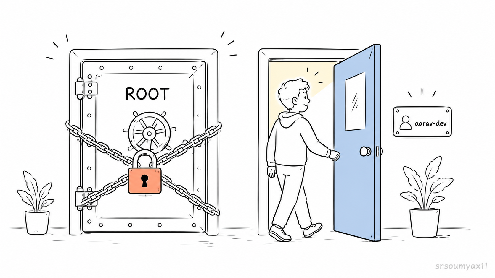

Aarav is ready to build the ordering backend.

But he needs somewhere to run it.

He messages Rohit:

> *"Hey — can you spin up a server for me? I need something to deploy the ordering system on."*

Rohit: *"On it."*

This is how real teams work. Aarav writes code. Rohit builds infrastructure. The separation isn't just cultural — it's enforced by the very IAM policies we set up in Chapter 4.3. Aarav's `PixelSpoon-Developer-EC2` policy doesn't include `ec2:CreateKeyPair`, `ec2:CreateSecurityGroup`, or `ec2:RunInstances`. He literally cannot provision a server even if he wanted to.

```json
{
  "Version": "2012-10-17",
  "Statement": [
    {
      "Effect": "Allow",
      "Action": [
        "ec2:Describe*",
        "ec2:StartInstances",
        "ec2:StopInstances",
        "ec2:GetConsoleOutput",
        "ec2-instance-connect:SendSSHPublicKey"
      ],
      "Resource": "*"
    }
  ]
}

```

That's Least Privilege doing its job.

So today — we follow Rohit first. Then we hand the server to Aarav.

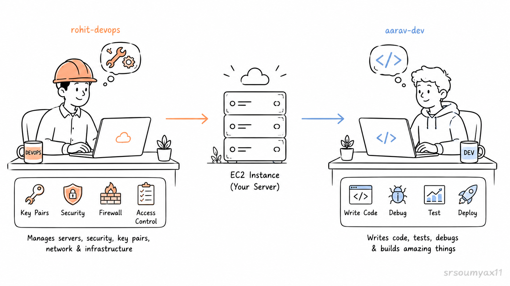

---

## 🔑 The IAM Sign-In URL — How the Team Logs In

Before anything gets built, let's fix something we glossed over in earlier chapters.

Every time we've opened the AWS console so far — we used the root account. That stops today permanently.

Each team member has their own IAM user and logs in through a dedicated URL that's specific to Pixel & Spoon's AWS account:

```
https://YOUR-ACCOUNT-ID.signin.aws.amazon.com/console
```

To find your account ID — log in to root one last time → click your account name top right → **Account**. The 12-digit Account ID is shown there.

Share that URL with your team. That's their front door. Not aws.amazon.com. That's for root only.

> 💡 You can make this URL friendlier by setting an **account alias** in the IAM dashboard. Instead of a 12-digit number, it becomes something like `https://pixelspoon.signin.aws.amazon.com/console`. Go to IAM → Dashboard → create alias on the right side.

**For this chapter:**

- **Rohit logs in as `rohit-devops`** to provision the server
- **Aarav logs in as `aarav-dev`** to connect and deploy the code
- Root stays locked

---

## 🖥️ What Is EC2?

Before Rohit launches anything — let's make sure we know what he's actually about to create.

**EC2** stands for **Elastic Compute Cloud**.

```
Elastic   →  Scales up or down based on demand
Compute   →  CPU, RAM — actual processing power
Cloud     →  Available over the internet, on AWS hardware
```

Remember Chapter 2 — virtualization? One physical server, sliced into many virtual machines by a hypervisor?

**EC2 is that virtual machine.** The one you rent. Running on AWS's physical hardware, in the Region you chose, isolated and yours alone.

In 1999, getting a server for Pixel & Spoon's ordering system would have taken weeks and cost lakhs before a single line of code ran on it. We covered that pain in Chapter 1.

Rohit will have one ready in under 10 minutes.


---

## 🧱 Three Decisions Rohit Makes Before Launching

---

### Decision 1 — The AMI: What OS Does the Server Run?

An **AMI** (Amazon Machine Image) is the operating system template — the base layer everything runs on.

Rohit picks **Amazon Linux 2023**.

Why?

- Built and optimised specifically for AWS
- Free — no licensing cost
- Pre-installed with the SSM agent (useful for secure connections later)
- Most AWS documentation uses it — easier to troubleshoot

---

### Decision 2 — The Instance Type: How Powerful?

```
t-series   →  General purpose, burstable performance
               Like a reliable everyday car — handles most tasks well,
               won't win a race but never lets you down
               Best for: web servers, APIs, small apps, learning
               ⭐ Rohit's choice: t3.micro — Free tier eligible ✅

c-series   →  Compute optimised, high CPU power
               Like a sports car — built for speed, not storage
               Best for: video processing, ML inference, game servers
               Example: c7g.large

r-series   →  Memory optimised, high RAM
               Like a moving truck — massive capacity, built to carry
               Best for: in-memory databases, large caches, analytics
               Example: r6g.large

m-series   →  Balanced CPU and memory, the production workhorse
               Like a reliable delivery van — good at everything,
               specialised at nothing
               Best for: production app servers, mid-size databases
               Example: m6i.large
```
Pixel & Spoon has zero users today. t3.micro is more than enough. When the app grows — Rohit can resize it. That's the elastic part.

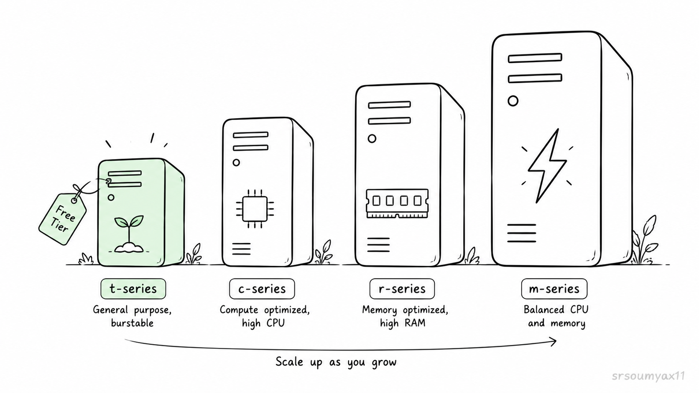

---

### Decision 3 — The Security Group: Which Ports Are Open?

A **Security Group** is the firewall around the EC2 instance. Every request that reaches the server passes through it first.

Least Privilege at the network level — only open what's actually needed.

Pixel & Spoon's backend needs exactly two ports:

```
Port 22    →  SSH access (for connecting to the server)
Port 3000  →  Node.js app (for users reaching the ordering system)
```

Not port 8080. Not port 443 "just in case." Not anything else.

Two ports. That's it.

The same principle from IAM policies applies here. Every unnecessary open port is an attack surface. Bots scan every public IP on the internet constantly — the smaller the surface, the safer the server.

---

## 🚀 Rohit Launches the Instance

**Rohit logs in as `rohit-devops`.**

---

**Step 1 — Open EC2**

Search `EC2` in the console → check Region is **ap-south-1 (Mumbai)** → click orange **Launch instance**.

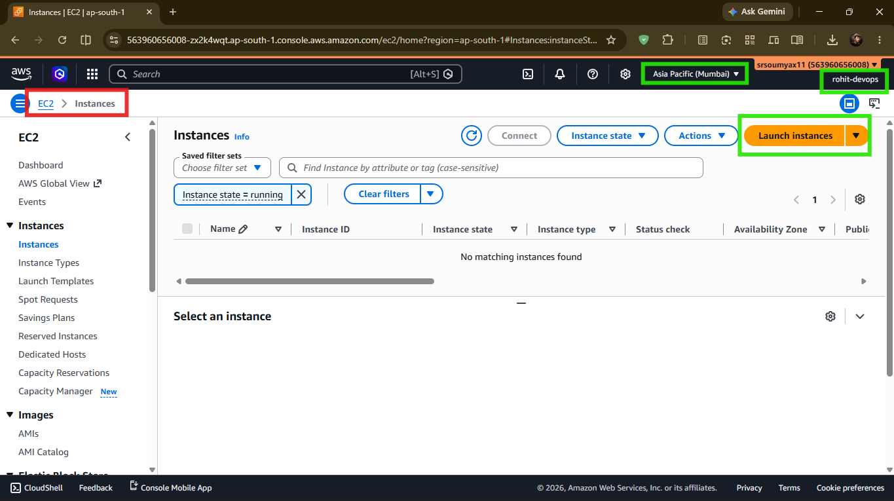

---

**Step 2 — Name the Instance**

```
pixel-spoon-backend
```

Lowercase, hyphens, descriptive. When Rohit is managing six instances at 2am, names matter.

---

**Step 3 — Choose the AMI**

Search **Amazon Linux 2023** → select it → confirm the **Free tier eligible** badge.

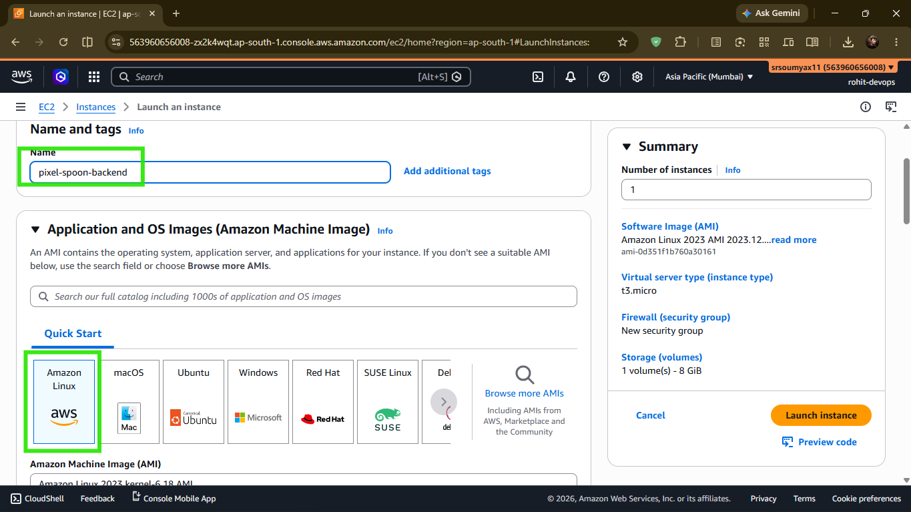
---

**Step 4 — Choose Instance Type**

Select **t3.micro** — confirm **Free tier eligible**.

---

**Step 5 — Create the Key Pair**

Click **Create new key pair**.

```
Key pair name:  pixelspoon-key
Key pair type:  RSA
Format:         .pem
```

Click **Create key pair** — the `.pem` file downloads immediately.

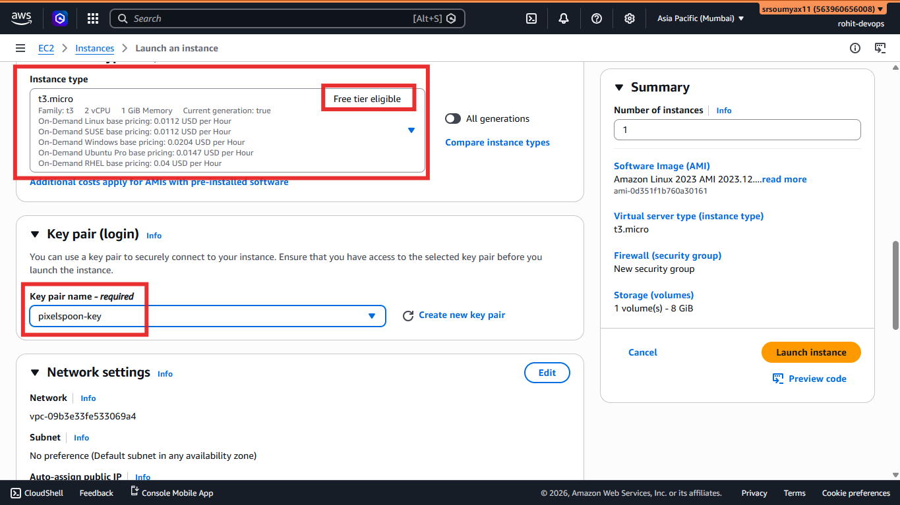

> ⚠️ **This file is shown once. There is no recovery.** Rohit moves it to a secure location immediately — not Downloads, not the Desktop. A dedicated credentials folder, or better yet, an encrypted vault.

Rohit will share this with Aarav through a secure channel — a password manager or encrypted file share. **Not Slack. Not email.**

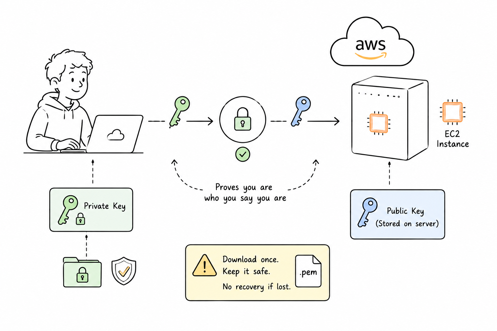

> 💡 Notice this step is done by Rohit, not Aarav. `aarav-dev` doesn't have `ec2:CreateKeyPair` in his policy — by design. Infrastructure credentials are DevOps territory. Aarav will use this key to connect, but he never created it. That's the separation working correctly.

---

**Step 6 — Configure the Security Group**

Under **Network settings** → click **Edit**.

Keep the default SSH rule (port 22). Add one more:

```
Type:        Custom TCP
Port:        3000
Source:      Anywhere (0.0.0.0/0)
Description: Pixel & Spoon Node.js ordering system
```

Two rules total. Done.

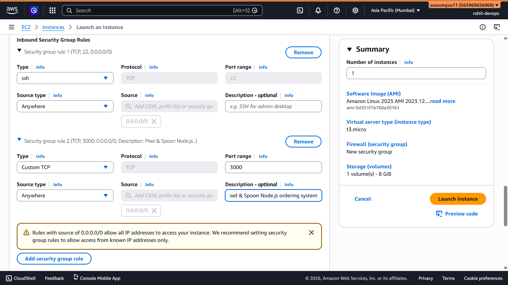

---

**Step 7 — Launch**

Leave storage at default 8GB → scroll down → **Launch instance**.

60–90 seconds. When **Instance state** shows **Running** — Pixel & Spoon's server is live.

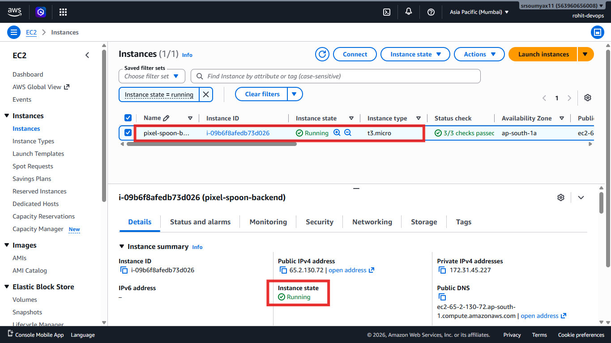

---

## 🤝 The Handoff

Rohit's work is done.

He sends Aarav two things:

```
📋 Public IPv4 address:  (copy from EC2 console instance details)
🔑 pixelspoon-key.pem:   (shared via secure channel)
```

Now it's Aarav's turn.

---

## 💻 Aarav Connects — Browser First

**Aarav logs in as `aarav-dev`.**

He opens EC2, finds `pixel-spoon-backend` in the instances list, selects it, and clicks the orange **Connect** button.
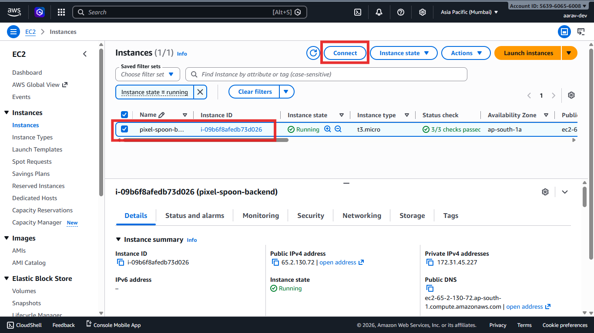

He stays on the **EC2 Instance Connect** tab — username is `ec2-user` — clicks **Connect**.


A terminal opens in the browser.

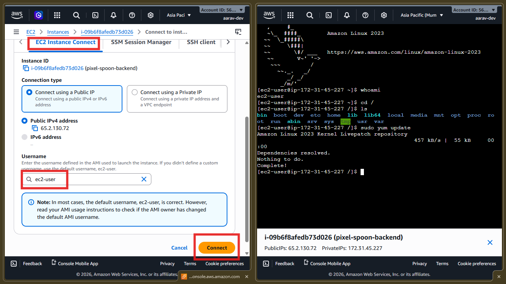

A machine running in a data center in Mumbai, responding to commands from Aarav's laptop.

That blinking cursor is the moment cloud computing stops being a concept and becomes real.

> 💡 EC2 Instance Connect is the quickest way in — no key file needed,
> works straight from the browser. But there are actually four ways
> to connect to an EC2 instance — including SSH from terminal on
> Mac, Linux, and Windows. We cover all of them in the companion post:
>
> 👉 **[Ch 5.1 — All Four Ways to Connect to EC2 → (Read it here)](LINK)**

---

## 📦 Aarav Deploys Pixel & Spoon's Code

The server is empty. The ordering system needs to get on it.

The right way — the way real teams do it — is Git. Code lives in 
a repository, versioned and safe. The server pulls it with one 
command. When the code changes, pull again.

First, install the dependencies:

```bash
sudo dnf update -y
sudo dnf install git nodejs -y
```

Then clone, checkout the Chapter 5 version, and run:

```bash
git clone https://github.com/srsoumyax11/pixel-and-spoon.git
cd pixel-and-spoon
git checkout ch05-start
npm install
npm start
```
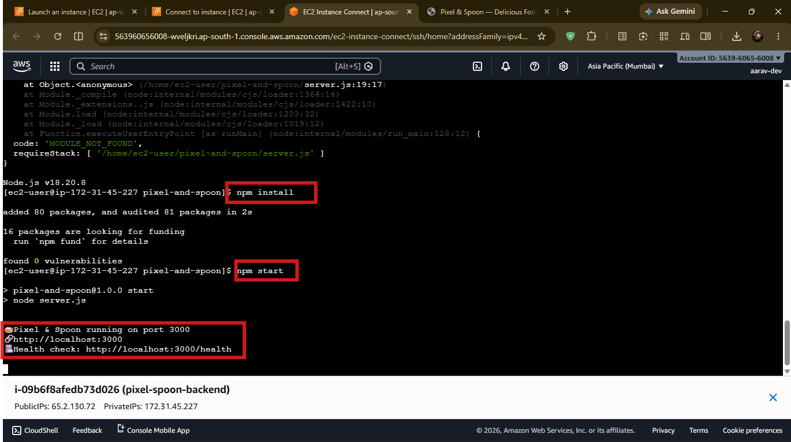

Open a browser and go to:

```
http://YOUR_PUBLIC_IP:3000
```

In my case it is [65.2.130.72:3000](http://65.2.130.72:3000/)

### Screenshot of the Website I built

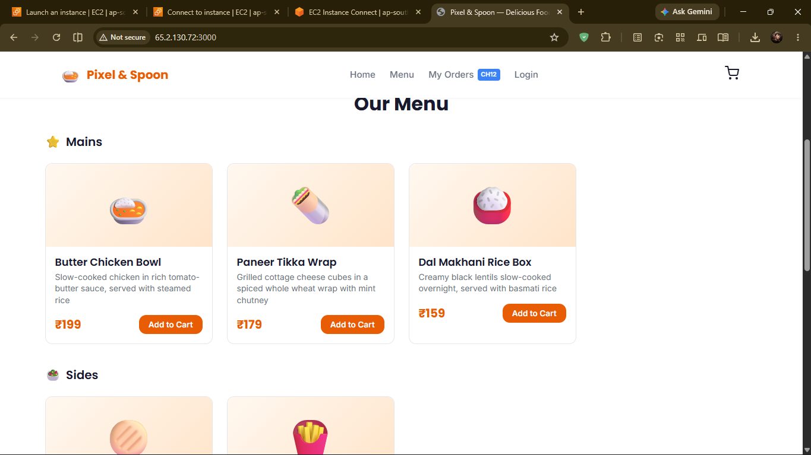
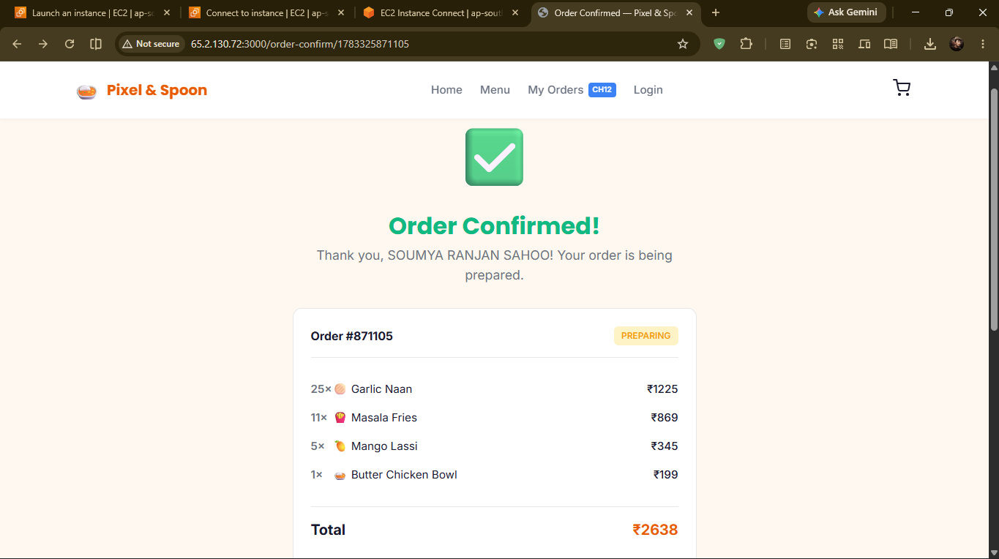
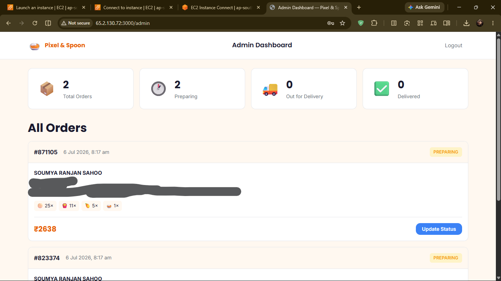

Pixel & Spoon's ordering system is live. On a real server. 
On the real internet.

> 💡 **Why `git checkout ch05-start`?**
>
> The repo grows alongside this series — by Chapter 12 it will
> have auth, by Chapter 16 it will have Secrets Manager 
> integration. The `ch05-start` tag freezes the codebase at 
> exactly what Aarav deployed today — so this tutorial works 
> correctly no matter when you're reading it.
>
> Each future chapter will have its own tag. You'll always know 
> exactly which version to run.


## ⭐ The Repo Behind This Series

The code Aarav just cloned is real — and you can use it yourself.

**[github.com/srsoumyax11/pixel-and-spoon](https://github.com/srsoumyax11/pixel-and-spoon)**

A fullstack Node.js server with two endpoints:

```
GET /        →  Pixel & Spoon's dynamic Server Side Rendered (SSR) ordering system
GET /health  →  Returns 
                {
                  "status": "ok",
                  "service": "pixel-spoon-backend",
                  "timestamp": "2026-07-06T08:10:24.199Z",
                  "uptime": 268.874721923,
                  "totalOrders": 0,
                  "version": "1.0.0"
                }
```
 — confirms the server is alive

**To use it:**

1. **Fork** the repo to your own GitHub
2. Clone your fork onto your EC2 instance
3. Runs on port 3000 — no config needed

> 🌟 *If this series has been useful — a star on the repo goes a long way.
> It helps other learners find it and keeps the series going.*
>
> **[⭐ Star it here → github.com/srsoumyax11/pixel-and-spoon](https://github.com/srsoumyax11/pixel-and-spoon)**

---

## 💰 What Is This Costing?

t3.micro — **750 free hours per month** for 12 months.

```
1 instance running 24/7   =  ~730 hrs/month  ✅ within free tier
2 instances running 24/7  =  ~1,460 hrs/month ❌ you pay for ~730
```

**The habit to build now:**

## When done for the day — **stop the instance**. Not terminate. Stop.

EC2 console → select instance → **Instance state** → **Stop instance**.

Data preserved. Config saved. Compute cost: zero.

---

## ⚠️ The Problem Nobody Wants to Say Out Loud

Pixel & Spoon is live. The health check returns green. Aarav is proud.

But Rohit is quiet.

Because right now, everything runs on **one server**.

One EC2 instance. One point of failure. If it crashes at 12:30pm during the lunch rush — every order fails. Every user sees an error. Every minute costs real trust.

And if a food blogger features Pixel & Spoon tomorrow and ten thousand users hit the app at once? One t3.micro will buckle.

This isn't Aarav's problem to fix. It's an infrastructure problem. And it's exactly what Rohit is going to solve in Chapter 6 — persistent storage that survives crashes, AMIs to clone servers in minutes, and Auto Scaling to handle any traffic spike without anyone losing sleep.

---

## 🗺️ Where We Go From Here

**Ch 00** — ✅ The origin story

**Ch 01** — ✅ The world before AWS

**Ch 02** — ✅ Virtualization & Cloud Models

**Ch 03** — ✅ Welcome to AWS

**Ch 04** — ✅ IAM: The Gatekeeper of AWS

> **Ch 04.1** — ✅ Creating IAM Users

> **Ch 04.2** — ✅ Creating IAM Groups

> **Ch 04.3** — ✅ Writing and Attaching IAM Policies

> **Ch 04.4** — ✅ Creating IAM Roles

**Ch 05** — ✅ EC2: Your First Server *(you are here)*

**Ch 05.1** — All Four Ways to Connect to EC2

**Ch 06** — EBS, AMI & Auto Scaling: The Complete Compute Picture

**Ch 07** — AWS CLI: Stop Clicking, Start Typing

**Ch 08** — S3: Store Anything, Forever

**Ch 09** — Databases on AWS: RDS & DynamoDB

**Ch 10** — Serverless: Lambda, SNS & SQS

**Ch 11** — Monitoring & Secrets: CloudWatch + Secrets Manager

**Ch 12** — Networking: Route 53, CloudFront & VPC

**Ch 13** — Infrastructure as Code: CloudFormation & Terraform

**Ch 14** — Containers: ECS & EKS

**Ch 15** — Billing & Pricing: Never Get a Surprise Bill

**Ch 16** — Capstone: Build a Full Stack App on AWS

**Ch 17** — AWS vs Azure vs GCP: An Honest Comparison

**Ch 18** — What's Next: The AWS Certifications Roadmap

---

### Before You Click Away.

Pixel & Spoon's server is running. The code is live. The health check is green.

But Rohit hasn't slept well since the launch.

One server. No redundancy. No way to survive a surge.

In Chapter 6, he fixes all of it.

👉 **[Chapter 6: EBS, AMI &amp; Auto Scaling → (Read it here)](LINK)**

---

*Resources I'm learning from:*

- *[roadmap.sh/aws](https://roadmap.sh/aws) — my learning roadmap*
- *[AWS Official Overview Whitepaper](https://docs.aws.amazon.com/whitepapers/latest/aws-overview/introduction.html) — straight from the source*

---

*#aws #cloud #ec2 #cloudcomputing*
