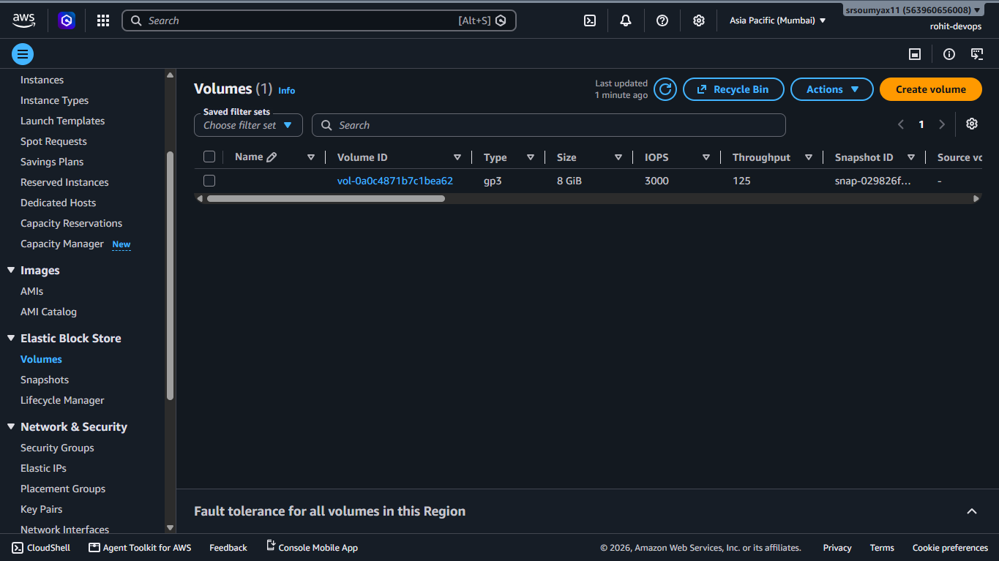
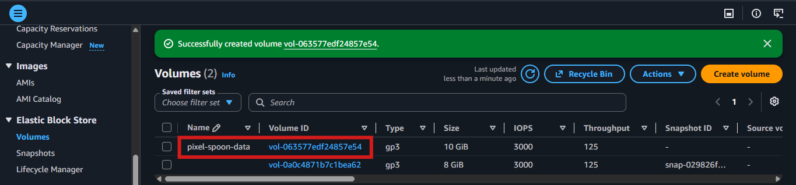
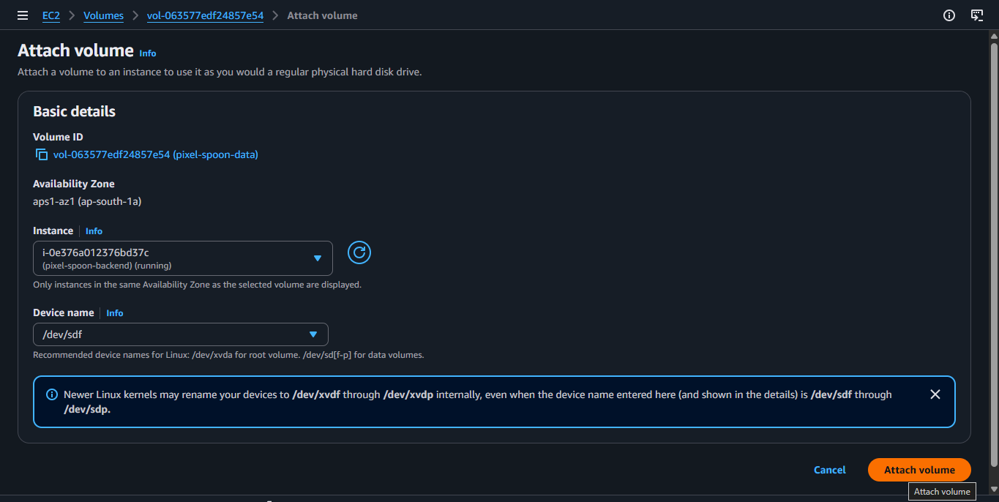
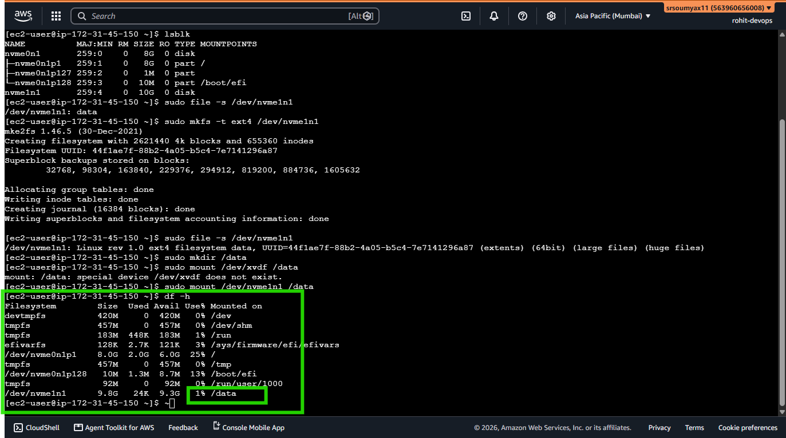

# Pixel & Spoon Hands-On: Attaching and Using an EBS Volume 💾

> *Chapter 6.1 — Hands-on companion to Chapter 6: EBS, AMI & Auto Scaling. The founder's Saturday morning message happened because orders lived in RAM. Today Rohit fixes that permanently.*

---

## The Problem in One Line

Every time Pixel & Spoon's server restarts — every order placed disappears.

That's because the app currently stores orders in a JavaScript array in memory. RAM is fast. RAM does not survive a restart.

You can test it by 
- running the server -> make some request -> Restart the server.
- You will see the order will not be there


The fix: attach an **EBS volume** — a persistent hard drive that exists independently of the EC2 instance — and tell the app to write orders there instead.

This is Rohit's job. He logs in as `rohit-devops`.

---

## 🗺️ What We're Building

```
Before:

🖥️ EC2 (pixel-spoon-backend)
   └── RAM → orders[] array
        └── Server restarts → array gone 💀

After:

🖥️ EC2 (pixel-spoon-backend)
   └── RAM → app runs here
   └── 📦 EBS Volume → /data/orders.json
        └── Server restarts → file still there ✅
```

Four stages to get there:

```
1️⃣  Create the EBS volume in AWS console
2️⃣  Attach it to the EC2 instance
3️⃣  Format and mount it inside the server
4️⃣  Update the app to write orders there
```

---

## 🛠️ Stage 1 — Create the EBS Volume

**Step 1** — In the AWS console, search `EC2` → in the left sidebar under **Elastic Block Store** → click **Volumes**.

You'll see one volume already listed — that's the root volume attached to your EC2 instance (the OS lives there). We're creating a separate one for data.



**Step 2** — Click the orange **Create volume** button.

**Step 3** — Configure it:

```
Volume type:        gp3  (General Purpose SSD — best default choice)
Size:               10 GiB  (more than enough for JSON order storage)
Availability Zone:  same as your EC2 instance ← CRITICAL
```

> ⚠️ **The AZ trap — most common beginner mistake.**
>
> EBS volumes can only attach to EC2 instances in the **same
> Availability Zone**. A volume in `ap-south-1a` cannot attach
> to an instance in `ap-south-1b` — even though they're in the
> same Region.
>
> To check your instance's AZ: EC2 → Instances → click
> `pixel-spoon-backend` → look for **Availability Zone** in
> the details panel. Match it exactly.

**Step 4** — Add a tag so it's easy to identify:

```
Key:    Name
Value:  pixel-spoon-data
```

**Step 5** — Click **Create volume**.

The volume status will show **available** within a few seconds.



---

## 🔗 Stage 2 — Attach It to the Instance

**Step 1** — Select the `pixel-spoon-data` volume you just created.

**Step 2** — Click **Actions** → **Attach volume**.

**Step 3** — In the Instance field, start typing `pixel-spoon` and select `pixel-spoon-backend` from the dropdown.

**Step 4** — Device name — AWS will suggest `/dev/sdf`. Leave it as is.

> 💡 Linux may show this as `/dev/xvdf` inside the instance even
> though the console shows `/dev/sdf`. This is normal — the
> kernel renames it. We'll find the actual name in Stage 3.

**Step 5** — Click **Attach volume**.



The volume status changes from **available** to **in-use**.

---

## ⚙️ Stage 3 — Format and Mount Inside the Server

The volume is physically attached — but the operating system doesn't know it's usable yet. Think of it like plugging in a brand new USB drive. You still need to format it before you can save files to it.

**Connect to the server** — Rohit opens EC2 Instance Connect as `rohit-devops`.

---

**Step 1 — Find the volume**

```bash
lsblk
```

You'll see output like this:

```
NAME          MAJ:MIN RM SIZE RO TYPE MOUNTPOINTS
nvme0n1       259:0    0   8G  0 disk 
├─nvme0n1p1   259:1    0   8G  0 part /
├─nvme0n1p127 259:2    0   1M  0 part 
└─nvme0n1p128 259:3    0  10M  0 part /boot/efi
nvme1n1       259:4    0  10G  0 disk 
```

`nvme1n1` is the new volume — no mountpoint yet, which means it's attached but not mounted.

---

**Step 2 — Check if it needs formatting**

```bash
sudo file -s /dev/nvme1n1
```

If the output shows `/dev/nvme1n1: data` — it's a blank, unformatted volume. Format it:

```bash
sudo mkfs -t ext4 /dev/nvme1n1
```

> ⚠️ Only run `mkfs` on a **new, empty volume**. Running it on
> a volume that already has data will wipe everything on it.
> The `file -s` check above tells you which situation you're in.

---

**Step 3 — Create a mount point**

```bash
sudo mkdir /data
```

This creates the folder where the volume's contents will be accessible.

---

**Step 4 — Mount the volume**

```bash
sudo mount /dev/nvme1n1 /data
```

---

**Step 5 — Verify it's mounted**

```bash
df -h
```

You should see something like:

```
Filesystem        Size  Used Avail Use% Mounted on
devtmpfs          420M     0  420M   0% /dev
tmpfs             457M     0  457M   0% /dev/shm
tmpfs             183M  448K  183M   1% /run
efivarfs          128K  2.7K  121K   3% /sys/firmware/efi/efivars
/dev/nvme0n1p1    8.0G  2.0G  6.0G  25% /
tmpfs             457M     0  457M   0% /tmp
/dev/nvme0n1p128   10M  1.3M  8.7M  13% /boot/efi
tmpfs              92M     0   92M   0% /run/user/1000
/dev/nvme1n1      9.8G   24K  9.3G   1% /data
```

`/data` is now live. Files written to `/data` go to the EBS volume.



---

## 🔁 Stage 3b — Make It Permanent (Survive Reboots)

There's one problem. If the server restarts right now — the mount disappears. The volume is still attached, but the OS won't know to mount it automatically.

Fix this by adding an entry to `/etc/fstab` — the file Linux reads on every boot to mount volumes.

**Step 1 — Get the volume's UUID**

```bash
sudo blkid /dev/nvme1n1
```

Output:

```
/dev/nvme1n1: UUID="a1b2c3d4-e5f6-..." TYPE="ext4"
```

Copy that UUID value.

**Step 2 — Edit fstab**

```bash
sudo nano /etc/fstab
```

Add this line at the bottom (replace with your actual UUID):

```
UUID=a1b2c3d4-e5f6-...   /data   ext4   defaults,nofail   0   2
```

> 💡 The `nofail` option is important — it means if the volume
> fails to mount for any reason, the server still boots normally
> instead of getting stuck. Always use `nofail` for data volumes.

Save and exit (`Ctrl+X`, then `Y`, then `Enter`).

**Step 3 — Test it without rebooting**

```bash
sudo mount -a
```

If this command runs without errors — fstab is correct. The volume will now mount automatically on every reboot.

---

## 📦 Stage 4 — Update the App to Use It

The volume is ready. Now the app needs to use it.

Pull the Chapter 6 version of Pixel & Spoon's code — this branch has the updated `data/orders.js` that writes to `/data/orders.json` instead of keeping orders in memory:

```bash
cd pixel-and-spoon
git fetch
git checkout ch06-ebs
npm install
```

Give the app permission to write to the `/data` folder:

```bash
sudo chown ec2-user:ec2-user /data
```

Then restart the app:

```bash
npm start
```

---

## ✅ Verify It Worked

**Test 1 — Place a test order**

Open `http://YOUR_PUBLIC_IP:3000` → add items to cart → place an order.

**Test 2 — Check the file was written**

```bash
cat /data/orders.json
```

You should see your order in the JSON file.

**Test 3 — Restart the app and check again**

```bash
# Stop the app (Ctrl+C) and restart
npm start
```

Open the admin dashboard at `http://YOUR_PUBLIC_IP:3000/admin`.

Your order is still there.

That's EBS working. Data that lives beyond the process, beyond the restart, independent of the instance itself.

The founder's Saturday morning message will never happen again.

---

## 💡 One More Thing — EBS Snapshots

Now that Pixel & Spoon's orders live on an EBS volume — what happens if the volume itself fails?

EBS volumes are highly durable (99.999% availability). But for production data, you should take regular **snapshots** — point-in-time backups stored in S3 automatically.

```bash
# Via console: EC2 → Volumes → select pixel-spoon-data
# → Actions → Create snapshot

# Or via CLI (we cover this in Chapter 7):
aws ec2 create-snapshot \
  --volume-id vol-xxxxxxxxx \
  --description "pixel-spoon-data backup $(date +%Y-%m-%d)"
```

We'll automate this properly in Chapter 7 when we cover the AWS CLI.

---

## 🗺️ Continue the Hands-On Series

**Ch 6.1** — ✅ Attaching and Using an EBS Volume *(you are here)*

**Ch 6.2** — Creating and Using an AMI (Golden Image)

**Ch 6.3** — Setting Up ELB and Auto Scaling

Next up — the volume is attached, the data is safe. Now Rohit captures the perfect server as a golden image so new instances can be stamped out in minutes.

👉 **[Chapter 6.2: Creating and Using an AMI → (Read it here)](LINK)**

---

*Resources I'm learning from:*
- *[roadmap.sh/aws](https://roadmap.sh/aws) — my learning roadmap*
- *[AWS Official Overview Whitepaper](https://docs.aws.amazon.com/whitepapers/latest/aws-overview/introduction.html) — straight from the source*

---

*#aws #cloud #ebs #handson*
