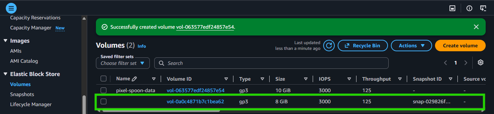
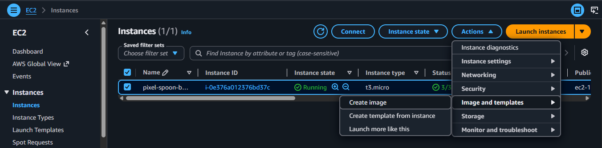
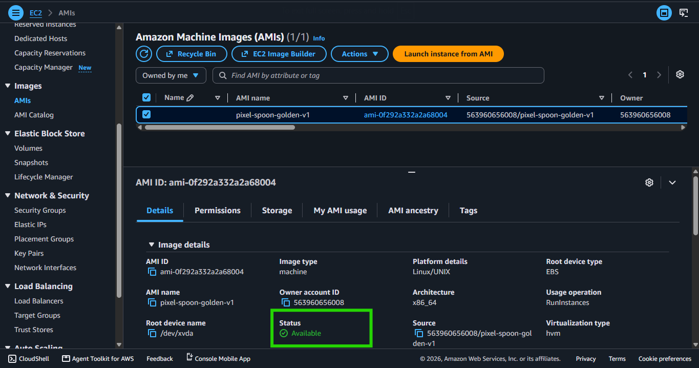
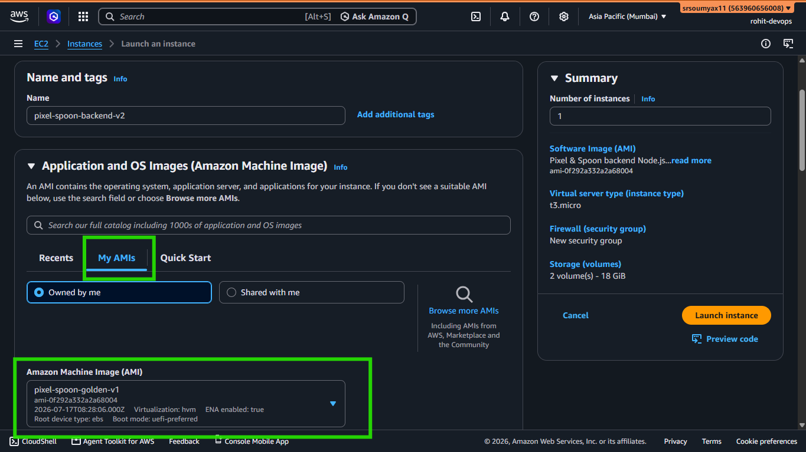

# Pixel & Spoon Hands-On: Creating and Using an AMI 📸

> *Chapter 6.2 — Hands-on companion to Chapter 6: EBS, AMI & Auto Scaling. Orders now survive restarts. But the server itself is still one crash away from hours of downtime. Rohit fixes that today.*

---

## The Problem With a Perfect Server

Rohit spent a good chunk of time getting `pixel-spoon-backend` exactly right.

Amazon Linux 2023 installed. Node.js configured. The repo cloned. The EBS volume mounted and wired into the app. Security groups set. Everything tested.

It works perfectly.

And that's exactly the problem.

All of that work lives on one EC2 instance. If that instance fails — hardware fault, accidental termination, anything — Rohit has to do all of it again. From scratch. While Pixel & Spoon is down. While hungry users are staring at error pages.

He needs a way to capture this perfect state and reproduce it instantly.

That's what an **AMI** does.

---

## 📷 What an AMI Actually Captures

Before Rohit creates anything, it's worth understanding exactly what goes into an AMI — and what doesn't.

When you create an AMI from a running EC2 instance, AWS takes a **snapshot of the root EBS volume** — the volume the operating system and everything installed on it lives on.



```
✅ What the AMI captures:
   - The operating system (Amazon Linux 2023)
   - Node.js installation
   - The cloned pixel-and-spoon repository
   - All npm packages
   - System configuration and security settings

❌ What the AMI does NOT capture:
   - The separate /data EBS volume (pixel-spoon-data)
   - That volume is attached independently and reattached manually
   - Live order data is safe — it lives on the EBS volume, not the AMI
```

This distinction matters. When Rohit launches a new server from the AMI — the app is there, pre-installed and ready. But he still needs to reattach the `/data` EBS volume separately. We'll do that in this chapter.


---

## 🛠️ Creating the AMI

Rohit is logged in as `rohit-devops`.

---

**Step 1 — Select the Instance**

EC2 console → **Instances** → click on `pixel-spoon-backend` to select it.

---

**Step 2 — Create Image**

**Actions** → **Image and templates** → **Create image**.



---

**Step 3 — Configure the Image**

```
Image name:         pixel-spoon-golden-v1
Image description:  Pixel & Spoon backend Node.js + app configured.
                    Ch06 version. EBS volume attached separately.
```

Name it with a version number from the start. You'll thank yourself when you have `v1`, `v2`, and `v3` and need to know which is which.

**Reboot instance** option — you'll see a checkbox here:

```
Reboot instance (recommended)
```

Leave it **Checked** (default).

> 💡 **What "Reboot instance (recommended)" means:**
>
> By default, AWS briefly stops and restarts your instance during
> AMI creation to ensure the filesystem is in a consistent state —
> like safely ejecting a USB drive before unplugging it.
>
> Checking "Reboot instance (recommended)" ensures the instance is rebooted
> before the AMI is created, which helps maintain data consistency.
>
> For a learning environment, either option works. For production
> — leave it checked. A few seconds of downtime during AMI
> creation is far better than a corrupted golden image.

---

**Step 4 — Create**

Click **Create image**.

AWS will show a success message with an AMI ID — something like `ami-0a1b2c3d4e5f67890`.

---

**Step 5 — Wait for it to become available**

Left sidebar → **AMIs** (under Images).

You'll see `pixel-spoon-golden-v1` with status **pending**.

```
Status timeline:
pending  →  (2–5 minutes)  →  available
```

Wait until it shows **available** before doing anything else.


---

## 🧪 Test It — Launch a New Instance From the AMI

An AMI is only useful if it actually works. Rohit tests it by launching a brand new instance from it.

---

**Step 1 — Launch Instance**

EC2 → **Launch instance** → under **Application and OS Images**, click **My AMIs**.

Select `pixel-spoon-golden-v1`.

---

**Step 2 — Configure**

```
Name:           pixel-spoon-backend-v2
Instance type:  t3.micro
Key pair:       pixelspoon-key  (existing — same one Rohit created)
Security group: Select existing → lunch-wizard-1 security group
```

> 💡 Using the same security group means port 22 and port 3000
> are already configured. Nothing to set up again.

Launch the instance.

---

**Step 3 — Connect and Verify**

Once running — connect via EC2 Instance Connect.

> 💡 **Make sure you're connected as `ec2-user`, not `root`.**
> When using EC2 Instance Connect, check the Username field
> before clicking Connect — change it to `ec2-user` if needed.
> The repo lives at `/home/ec2-user/pixel-and-spoon`.
> If you connected as root, use the full path instead:
> `ls /home/ec2-user/pixel-and-spoon`

Check Node.js is there:

```bash
node --version
```

Check the repo is there:


```bash
ls ~/pixel-and-spoon
```

Both should return immediately. No installation needed. No cloning. Everything was baked into the AMI.



---

## 🔌 Reattaching the EBS Data Volume

The new instance is running. But the orders are still on the `pixel-spoon-data` EBS volume — which is currently attached to the original instance.

In a real incident scenario, the original instance would be gone. So Rohit detaches the volume from the old instance and reattaches it to the new one.

---

**Step 1 — Detach from old instance**

EC2 → **Volumes** → select `pixel-spoon-data`.

**Actions** → **Detach volume** → confirm.

Status changes to **available**.

> ⚠️ Only detach a volume from a running instance if the app
> has been stopped first. Detaching a volume that's actively
> being written to can corrupt data. Stop the Node.js process
> before detaching.

---

**Step 2 — Attach to new instance**

With `pixel-spoon-data` still selected → **Actions** → **Attach volume**.

Select `pixel-spoon-backend-v2` → device name `/dev/sdf` → **Attach volume**.

---

**Step 3 — Verify auto-mount**

Connect to `pixel-spoon-backend-v2` via EC2 Instance Connect.

```bash
df -h
```

Look for `/data` in the output:

```
Filesystem      Size  Used Avail Use% Mounted on
/dev/xvda1      8.0G  2.1G  5.9G  27% /
/dev/xvdf       7.9G  1.2M  7.5G   1% /data
```

`/data` is mounted automatically — because we added it to `/etc/fstab` in Chapter 6.1.

That's why the fstab step mattered. Rohit doesn't have to run a single mount command manually. The new server knows exactly what to do.

---

**Step 4 — Start the app**

```bash
cd pixel-and-spoon
npm start
```

Open `http://NEW_PUBLIC_IP:3000/admin`

Every order from the previous server is there.

Same data. New server. Zero data loss.

---

## 📋 The AMI Versioning Habit

Now that `pixel-spoon-golden-v1` exists, Rohit makes a simple rule for the team:

> *Every time a significant change is made to the server configuration — create a new AMI.*

```
pixel-spoon-golden-v1  →  Ch06 baseline (current)
pixel-spoon-golden-v2  →  After adding monitoring agent (Ch15)
pixel-spoon-golden-v3  →  After adding Secrets Manager config (Ch16)
```

Never overwrite an old AMI. Keep previous versions. If a new AMI has a problem, roll back by launching from the previous one.

---

## 🧹 Cleaning Up Old AMIs (Don't Forget This)

AMIs aren't free to keep indefinitely.

Each AMI references one or more **EBS snapshots** — and snapshots have a small storage cost (roughly $0.05 per GB per month). For a learning account with a few AMIs, that's negligible. For a production account with hundreds of old AMIs — it adds up.

When an AMI is no longer needed:

**Step 1** — EC2 → AMIs → select the old AMI → **Actions** → **Deregister AMI**.

**Step 2** — EC2 → Snapshots → find the snapshot associated with that AMI → **Actions** → **Delete snapshot**.

Both steps are required. Deregistering the AMI alone doesn't delete the underlying snapshot.

---

## ✅ Where Pixel & Spoon Stands Now

```
📦 pixel-spoon-data (EBS Volume)
   └── /data/orders.json — persists across restarts ✅

📸 pixel-spoon-golden-v1 (AMI)
   └── Node.js + app + config — reproducible in minutes ✅

🖥️ pixel-spoon-backend-v2 (new EC2 instance from AMI)
   └── App running, data volume attached, orders intact ✅
```

If the server fails tonight — Rohit launches a new one from the AMI, reattaches the EBS volume, starts the app. Pixel & Spoon is back online in under 10 minutes.

That's the power of a golden image.

---

## 🗺️ Continue the Hands-On Series

**Ch 6.1** — ✅ Attaching and Using an EBS Volume

**Ch 6.2** — ✅ Creating and Using an AMI *(you are here)*

**Ch 6.3** — Setting Up ELB and Auto Scaling

The AMI exists. Data persists. But one server still isn't enough for a lunch-hour traffic spike.

In 6.3 — Rohit puts a load balancer in front of Pixel & Spoon and sets up Auto Scaling so the system adds servers automatically when CPU climbs and removes them when traffic drops. The `/health` endpoint finally gets used the way it was designed.

👉 **[Chapter 6.3: Setting Up ELB and Auto Scaling → (Read it here)](LINK)**

---

*Resources I'm learning from:*
- *[roadmap.sh/aws](https://roadmap.sh/aws) — my learning roadmap*
- *[AWS Official Overview Whitepaper](https://docs.aws.amazon.com/whitepapers/latest/aws-overview/introduction.html) — straight from the source*

---

*#aws #cloud #ec2 #handson*
