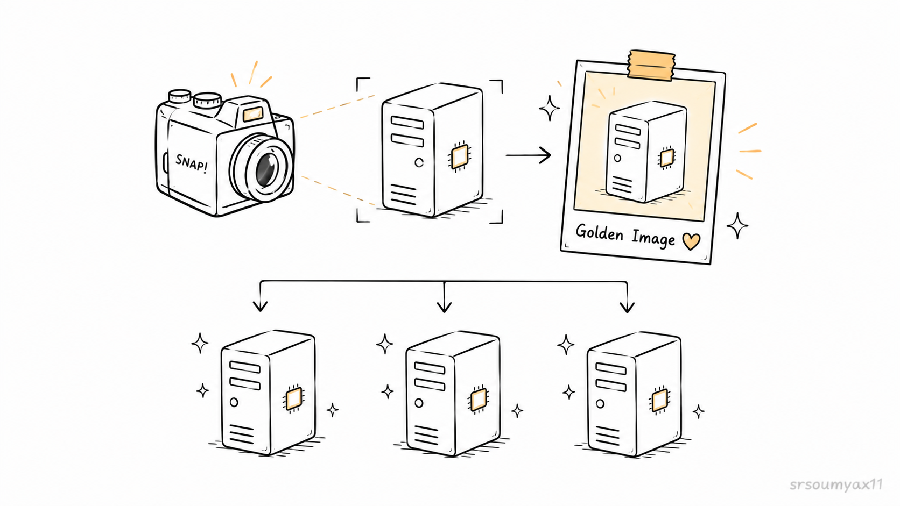
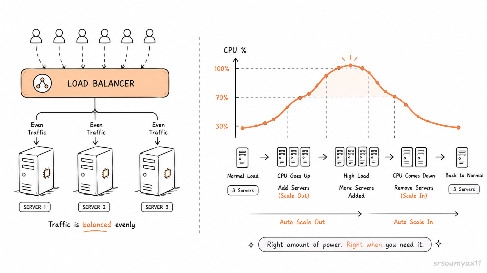
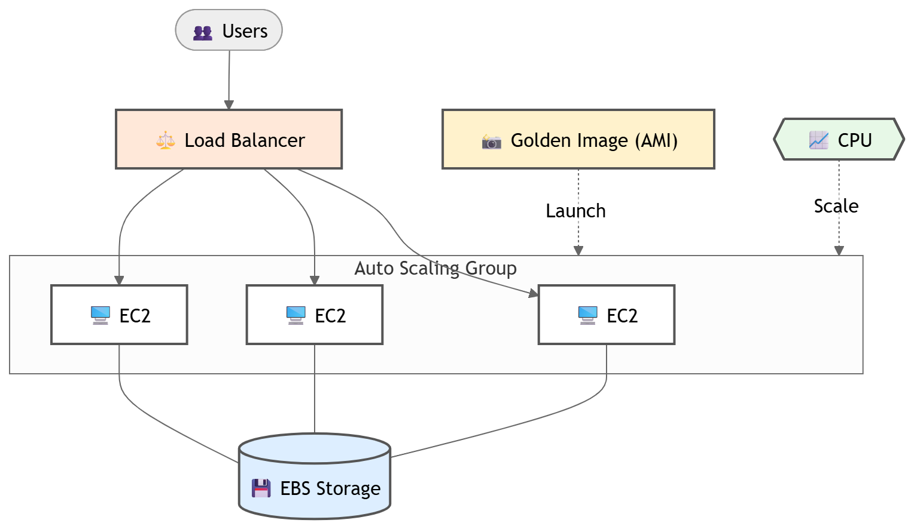

# EBS, AMI & Auto Scaling: The Complete Compute Picture 🏗️

> *Chapter 6 of the AWS Learning Journey. Pixel & Spoon is live. But live isn't the same as resilient. Rohit is about to find that out the hard way.*

---

## Saturday Morning. 7:43am.

Rohit is making chai when his phone buzzes.

It's the founder.

> *"Hey — the server restarted last night during the maintenance window. All our test orders are gone. Is that normal?"*

Rohit stares at his phone.

He knows exactly what happened. The EC2 instance restarted. And when it did — the Node.js process came back up fresh. Clean slate. In-memory storage, wiped completely.

Every order placed during yesterday's testing session. Gone.

He types back:

> *"Yes. It's normal for now. I'll fix it today."*

He puts his phone down and opens his laptop.

Because "normal for now" is not good enough for a food delivery app that's about to go live.

---

## 🔍 Three Problems. One Chapter.

What Rohit realises over his chai is that Pixel & Spoon has not one problem — but three. And they're all connected.

```
Problem 1 → Data disappears when the server restarts
Problem 2 → If the server crashes, rebuilding takes hours
Problem 3 → One server can't handle a real traffic spike
```

Each problem has a solution. And each solution builds on the last.

This is the chapter where Pixel & Spoon stops being a demo and starts being infrastructure.

---

## 💾 Problem 1: Data Dies With the Server

Here's what's happening under the hood.

When Pixel & Spoon's Node.js app runs, orders are stored in a JavaScript array — in the server's RAM. RAM is fast. RAM is temporary. The moment the process stops — whether from a crash, a restart, or a deployment — that array is gone.

This is fine for learning. It's a disaster for production.

Rohit needs storage that survives independently of the server. Storage that exists even when the EC2 instance is stopped, restarted, or replaced.

That's **EBS** — Elastic Block Store.

---

### 🗄️ What Is EBS?

Think of EC2 as a laptop. When you buy a laptop, it comes with a hard drive — that's where your files live. You can also plug in an external hard drive — more storage, separate from the laptop itself.

EBS is that external hard drive. But for EC2.

```
Without EBS:

🖥️ EC2 Instance
   └── RAM (orders stored here)
        └── Server restarts → RAM cleared → orders gone 💀

With EBS:

🖥️ EC2 Instance
   └── RAM (app runs here)
   └── 📦 EBS Volume (orders written here)
        └── Server restarts → EBS untouched → orders safe ✅
```

An EBS volume is a network-attached storage device. It exists independently of any EC2 instance. You can attach it, detach it, and reattach it to a different instance. You can take snapshots of it for backup. You can resize it without stopping the instance.


Rohit attaches an EBS volume to Pixel & Spoon's server. He updates the app to write orders to a JSON file on it instead of keeping them in memory.

Now when the server restarts — the orders are still there.

The founder's Saturday morning message will never happen again.

> 🛠️ **Hands-on:** Ready to attach an EBS volume and update Pixel & Spoon's app to use it?
> 👉 **[Ch 6.1 - Attaching and Using an EBS Volume  → (Read it here)](LINK)**

---

## 📸 Problem 2: Rebuilding From Scratch Takes Hours

EBS solves the data problem. But Rohit is thinking ahead.

What if the EC2 instance itself fails?

Not a restart. A complete failure. The instance is gone. He needs to launch a new one.

He'd have to:

- Launch a fresh EC2 instance
- Install Node.js
- Clone the repository
- Mount the EBS volume
- Configure the security groups
- Test everything

That's not minutes. That's hours. Hours during which Pixel & Spoon is completely down.

For a food delivery app — especially during lunch hour — that's unacceptable.

Rohit needs a way to stamp out a perfect, pre-configured server in minutes. Not from scratch. From a template.

That's **AMI** — Amazon Machine Image.

---

### 📷 What Is an AMI?

Remember Chapter 5 — when we launched the EC2 instance and chose Amazon Linux 2023 as the operating system? That was an AMI. A template that the instance was built from.

You can create your own.

Once Rohit has Pixel & Spoon's server perfectly configured — Node.js installed, app cloned, EBS mounted, security rules set — he takes a snapshot of the entire instance. That snapshot becomes a custom AMI.

```
Current Server (perfectly configured):
🖥️ EC2: pixel-spoon-backend
   ├── Amazon Linux 2023
   ├── Node.js installed
   ├── pixel-and-spoon repo cloned
   ├── EBS volume mounted
   └── Security groups configured

          ↓  Create AMI

📸 AMI: pixel-spoon-golden-image
   └── An exact copy of everything above, frozen in time

          ↓  Launch from AMI anytime

🖥️ New EC2 instance — identical to original, ready in minutes
```

This is called a **golden image**. The perfect server, captured once, reproducible forever.

If the production server fails at 1pm on a Wednesday — Rohit launches a new instance from the AMI. The new server comes up pre-configured, pre-installed, pre-everything. Pixel & Spoon is back online in minutes, not hours.




> 🛠️ **Hands-on:** Want to create Pixel & Spoon's golden image?
> 👉 **[Ch 6.2 — Creating and Using an AMI → (Read it here)](LINK)**

---

## 📈 Problem 3: One Server Can't Handle Real Traffic

It's Tuesday afternoon. Rohit is about to close his laptop.

His phone buzzes again. This time it's Aarav.

> *"Bro — check Twitter. Someone just mentioned Pixel & Spoon."*

Rohit opens Twitter.

A food blogger with 200,000 followers just posted:

> *"Just discovered @PixelandSpoon and honestly? The butter chicken bowl might be life. Everyone go order now 🍛"*

Rohit watches the EC2 CPU monitor in CloudWatch.

```
2:14pm  →  CPU: 12%   (normal)
2:15pm  →  CPU: 34%   (spike starting)
2:16pm  →  CPU: 67%   (getting serious)
2:17pm  →  CPU: 89%   (danger zone)
2:18pm  →  CPU: 98%   (app slowing down)
2:19pm  →  Users start seeing slow load times
2:20pm  →  First timeout errors appear
```

One t3.micro. Thousands of users. The math doesn't work.

Rohit needs more servers. Right now. Not in 20 minutes — **right now**.

And when the traffic dies down at 4pm — he needs those extra servers gone so Pixel & Spoon isn't paying for capacity it doesn't need.

That's **ELB + Auto Scaling**.

---

### ⚖️ What Is a Load Balancer?

A **load balancer** sits in front of your servers. Every request that comes in hits the load balancer first. The load balancer then decides which server handles it — distributing the load evenly.

```
Without ELB:

1000 users  →  🖥️ pixel-spoon-backend  →  💀 overwhelmed

With ELB:

                  ┌→  🖥️ Server 1  (healthy ✅)
1000 users →  ELB ─→  🖥️ Server 2  (healthy ✅)
                  └→  🖥️ Server 3  (healthy ✅)
```

No single server gets overwhelmed. If one server goes down — the load balancer stops sending traffic to it and the others pick up the slack.

Remember the `/health` endpoint we built in Chapter 5?

```json
GET /health
{
  "status": "ok",
  "service": "pixel-spoon-backend"
}
```

That wasn't just for show. **ELB pings that endpoint every 30 seconds.** If a server stops returning `"status": "ok"` — ELB marks it unhealthy and stops sending it traffic. Automatically. No human intervention needed.

---

### 📊 What Is Auto Scaling?

A load balancer distributes traffic. But it can't create new servers.

That's what an **Auto Scaling Group** (ASG) does.

You define the rules:

```
Minimum servers:   1   (always at least one running)
Maximum servers:   6   (never spin up more than six)
Scale out when:    CPU > 70% for 2 minutes → add 1 server
Scale in when:     CPU < 30% for 5 minutes → remove 1 server
```

When the food blogger posts and CPU hits 89% — ASG detects it, launches a new EC2 instance from Pixel & Spoon's AMI (this is why the golden image matters), and registers it with the load balancer automatically.

When traffic dies down — ASG terminates the extra instances. Pixel & Spoon stops paying for them.

```
2:14pm  →  1 server running       CPU: 12%
2:16pm  →  1 server running       CPU: 67%  ← ASG triggers
2:18pm  →  2 servers running      CPU: 41%  ← load distributed
2:20pm  →  3 servers running      CPU: 28%  ← stable
4:00pm  →  traffic drops          CPU: 8%   ← ASG triggers
4:05pm  →  2 servers running      CPU: 11%
4:15pm  →  1 server running       CPU: 9%   ← back to baseline
```

Scale up when you need it. Scale down when you don't. Pay for exactly what you use.

This is the elastic part of Elastic Compute Cloud **(EC2)** — finally being used the way it was designed.




> 🛠️ **Hands-on:** Set up a load balancer and auto scaling group for Pixel & Spoon:
> 👉 **[Ch 6.3 — Setting Up ELB and Auto Scaling → (Read it here)](LINK)**

### ⚠️ **The shared storage problem**

> Sharp readers will notice something: if ASG spins up three 
> EC2 instances, each one needs access to the same orders.
> But EBS volumes can only attach to one instance at a time.

> Instance 1 has the orders. Instance 2 and 3 don't.
> A user routed to Instance 2 sees an empty order history.
>
> This is a real limitation — and it's exactly why file-based
> storage on EBS doesn't scale horizontally.
>
> The real fix is a **shared database** that all instances
> connect to independently. That's Chapter 10 — RDS.
> Every instance queries the same database. Problem solved.
>
> For now, Pixel & Spoon runs on a single instance with EBS.
> The load balancer and ASG are ready — we just need a proper
> database before we can use them fully.

---

## 🧩 How It All Connects

Step back and look at what Rohit built today.

```
📦 EBS Volume
   └── Orders survive server restarts
   └── Data exists independently of any instance

📸 AMI (Golden Image)
   └── Perfect server captured once
   └── New servers launch pre-configured in minutes
   └── ASG uses this to create new instances automatically

⚖️ ELB + Auto Scaling Group
   └── Traffic distributed across multiple instances
   └── Unhealthy instances removed automatically (/health endpoint)
   └── New instances launched from AMI when CPU spikes
   └── Extra instances terminated when traffic drops
```

These three aren't separate features. They're one system.

EBS gives data persistence. AMI makes servers reproducible. ELB + ASG makes the whole thing elastic.

Without EBS — restarting any server loses data.
Without AMI — Auto Scaling can't launch pre-configured servers fast enough.
Without ELB + ASG — one server is still a single point of failure.

Together — Pixel & Spoon can handle a food blogger with 200,000 followers and not even break a sweat.

---

## 🌅 Rohit Finally Sleeps

It's 11pm. Rohit closes his laptop.

The load balancer is routing traffic. The auto scaling group is watching CPU. The EBS volume is safely holding every order. The golden AMI is sitting ready to stamp out new servers at a moment's notice.

He sets his phone to Do Not Disturb.

For the first time since Pixel & Spoon launched — he's not worried about what happens while he sleeps.

That's what resilient infrastructure feels like.



---

## 🗺️ Where We Go From Here


**Ch 00** — ✅ The origin story

**Ch 01** — ✅ The world before AWS

**Ch 02** — ✅ Virtualization & Cloud Models

**Ch 03** — ✅ Welcome to AWS

**Ch 04** — ✅ IAM: The Gatekeeper of AWS

**Ch 04.1** — ✅ Creating IAM Users

**Ch 04.2** — ✅ Creating IAM Groups

**Ch 04.3** — ✅ Writing and Attaching IAM Policies

**Ch 04.4** — ✅ Creating IAM Roles

**Ch 05** — ✅ EC2: Your First Server

**Ch 05.1** — ✅ All Four Ways to Connect to EC2

**Ch 06** — ✅ EBS, AMI & Auto Scaling *(you are here)*

**Ch 06.1** — Attaching and Using an EBS Volume

**Ch 06.2** — Creating and Using an AMI

**Ch 06.3** — Setting Up ELB and Auto Scaling

**Ch 07** — AWS CLI: Stop Clicking, Start Typing

**Ch 08** — S3: Store Anything, Forever

**Ch 09** — S3 in Practice: Host a Real Website

**Ch 10** — RDS: Databases Without the Headache

**Ch 11** — DynamoDB: When SQL Isn't Enough

**Ch 12** — Cognito: Real Auth for Pixel & Spoon

**Ch 13** — Lambda: Code That Runs Itself

**Ch 14** — SNS & SQS: Making Services Talk to Each Other

**Ch 15** — CloudWatch: Know What's Happening Inside AWS

**Ch 16** — Secrets Manager: Store Secrets Safely

**Ch 17** — Route 53: Give Your App a Real Address

**Ch 18** — CloudFront: Deliver Fast, Everywhere

**Ch 19** — VPC: Your Private Corner of AWS

**Ch 20** — CloudFormation: Build Infrastructure With Code

**Ch 21** — Terraform: IaC Beyond AWS

**Ch 22** — ECS: Running Containers on AWS

**Ch 23** — EKS: Kubernetes on AWS

**Ch 24** — Billing & Pricing: Never Get a Surprise Bill

**Ch 25** — Capstone: Full Stack Pixel & Spoon on AWS

**Ch 26** — AWS vs Azure vs GCP: An Honest Comparison

**Ch 27** — What's Next: AWS Certifications Roadmap

---

### Before You Click Away.

Pixel & Spoon is resilient now. Data persists. Servers are reproducible. Traffic is handled automatically.

But Rohit has been doing everything through the AWS console — clicking, scrolling, filling in forms.

There's a faster way.

In Chapter 7, Aarav shows Rohit something that changes how they both work — the AWS CLI. Everything they've done in the last three chapters, done in a single line from the terminal. The first step toward real automation.

👉 **[Chapter 7: AWS CLI — Stop Clicking, Start Typing → (Read it here)](LINK)**

---

*Resources I'm learning from:*
- *[roadmap.sh/aws](https://roadmap.sh/aws) — my learning roadmap*
- *[AWS Official Overview Whitepaper](https://docs.aws.amazon.com/whitepapers/latest/aws-overview/introduction.html) — straight from the source*

---

*#aws #cloud #ec2 #devops*
